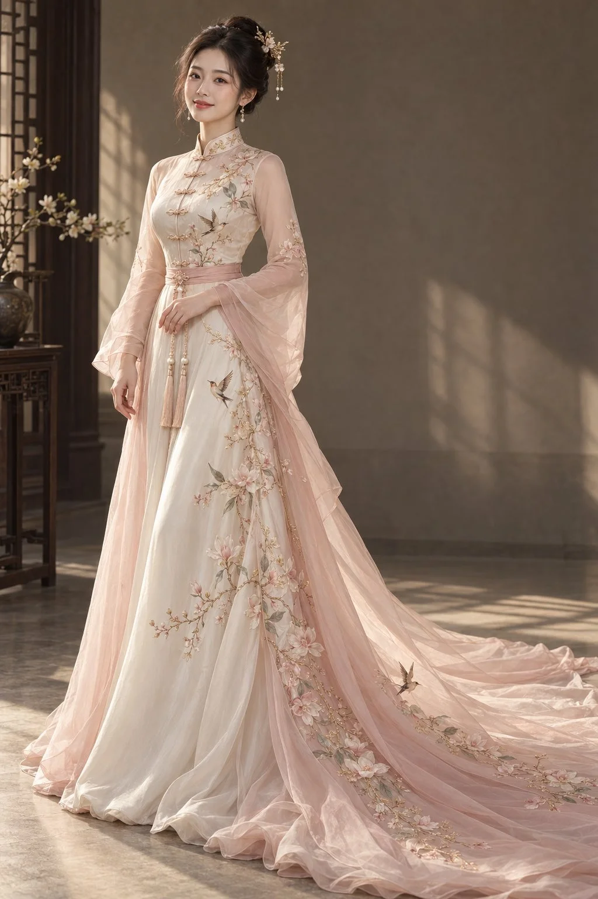

# New Chinese-Style Champagne Satin Gown Full-Body Portrait

**中文标题：** 新中式香槟缎面礼服全身人像  
**ID:** `gi25-x-1009` · **Mode:** `generate`  
**Categories:** `general`  
**Tags:** `x-twitter`, `community`, `gpt-image-2.5`, `x-direct`, `zh`



### New Chinese-Style Champagne Satin Gown Full-Body Portrait

```text
一张写实的新中式高级礼服全身人像。成年东方女性，身形自然匀称，中等身高，真实头身比例。竖版构图，完整展示发饰、袖型、裙摆与铺地拖尾。

【服装设计】
香槟象牙白真丝缎面与藕粉色轻薄欧根纱搭配，精致小立领，领缘绣细窄浅金纹样，胸前排列小巧手工盘扣。肩线自然贴合，上身采用不透明缎面，合体剪裁，腰线自然。

长袖以半透明藕粉绣纱制作，上臂较合体，从手肘以下柔和展开，形成轻盈飘逸的微喇袖口。腰间搭配窄幅藕粉腰封、小巧花形扣与两条珍珠流苏。

裙身从腰胯顺势舒展，象牙白缎面内裙叠搭藕粉薄纱外裙，轮廓柔顺，具有适度裙量。前裙边轻轻堆叠于地面，侧后方拖尾与裙身连贯，沿地面自然铺开，褶皱细腻、垂坠真实。

【刺绣纹样】
以浅粉与象牙白玉兰、细小花枝和灵动飞鸟为主题，点缀低饱和灰绿叶片与极细香槟金绣线。纹样从单侧肩胸经过腰间，延伸至裙摆和拖尾，疏密有致，保留大面积素色面料。绣线针脚清晰，花瓣具有细微立体层次，整体精致轻盈。

【人物造型】
自然东方成年女性面容，眼睛大小真实，五官比例协调，面部保留轻微不对称。皮肤白皙细腻、柔和通透，保留细微肌理、自然血色和真实唇纹。轻薄妆容，温柔淡笑，避免瓷娃娃感与过度磨皮。

深色头发盘成优雅高髻，佩戴精巧金色花枝发簪、少量珍珠垂饰与小巧耳坠。人物微侧站立，一手自然置于腰前，另一手放松垂落，肩颈舒展，姿势自然。

【背景与光线】
低调雅致的暖灰米色室内背景，一侧有深木格栅与轻微虚化的花器，背景留白充足。柔和侧窗光结合自然反射补光，面部明暗过渡细腻，皮肤高光不过曝。窗影轻落于墙面与地面，真丝、薄纱、绣线和珍珠具有各自真实的光泽。

高端时装摄影，平视机位，自然透视，真实相机质感，画面重点突出人物与礼服，完整保留裙摆和拖尾。

避免：僵硬蓬蓬裙、厚重织锦、独立长条拖布、夸张拉长的身材、塑料皮肤、动漫大眼、畸形手指、云肩、厚重肩饰、文字、水印、拼图。
```

- **Recommended model:** `gpt-image-2.5-sunburst`
- **Settings:** _(defaults)_
- **Source:** [community](https://x.com/krienknight/status/2113086678600700190) — @krienknight
- **License note:** Original public X post; quoted with attribution — remix with attribution
- **Notes:** Collected directly from X; prompt posted as the author's reply https://x.com/krienknight/status/2113086678600700190 to https://x.com/krienknight/status/2113086672065974417, which carries the images and names GPT Image 2.5; discovered via Bin0754/gpt-image-gallery index, prompt re-verified against the original X post via api.fxtwitter.com; verified=True
- **Preview:** `previews/gi25-x-1009.webp`
