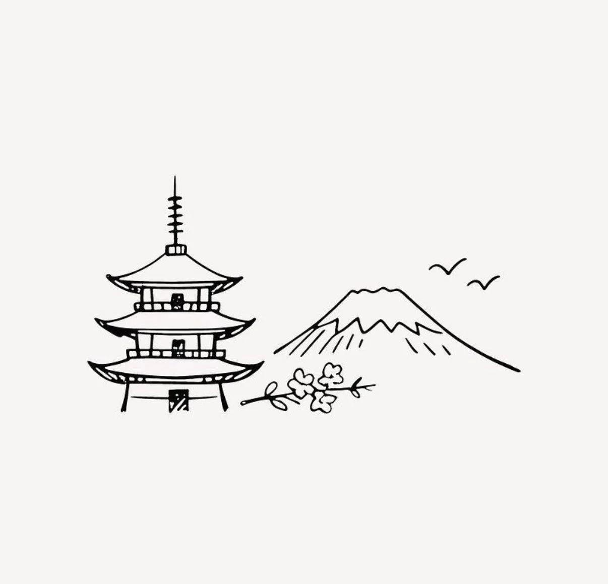

# Minimalist Ink Line Travel Illustration Template

**中文标题：** 极简钢笔线描旅行插画模板  
**ID:** `gi25-x-1010` · **Mode:** `generate`  
**Categories:** `general`  
**Tags:** `x-twitter`, `community`, `gpt-image-2.5`, `x-direct`, `en`



### Minimalist Ink Line Travel Illustration Template

```text
Create a beautiful, minimalist, hand-drawn travel illustration

Art style: Fine black ink line drawing on a clean, warm-white paper background, delicate imperfect strokes, loose pencil shading, subtle cross-hatching, artistic simplicity, and a timeless European journal aesthetic.

Composition: Arrange a few charming objects in the foreground that represent the destination, such as a steaming coffee cup, croissant, a slender glass vase holding a single flower, and a small upright postcard or book featuring the iconic architecture or landmark of [CITY / COUNTRY / LANDMARK].

Landmark details: Illustrate the destination’s most recognizable landmark with delicate hand-drawn lines, keeping it simple, elegant, and instantly recognizable. Add small decorative handwritten lettering featuring the destination’s name.

Mood: Peaceful, romantic, cozy, nostalgic, artistic, and dreamy, like a page from a vintage travel diary in a Parisian café.

Background: Plain white or ivory paper with generous negative space, no unnecessary scenery, no borders, and no distracting elements.

Technical style: Monochrome black ink, fine sketch lines, natural imperfections, delicate shadows beneath the objects, subtle paper texture, balanced horizontal composition, understated editorial illustration, high-resolution artwork.

Replace every instance of [CITY / COUNTRY / LANDMARK] with your chosen destination. Keep the same overall composition and artistic style while changing the landmark and cultural details to match the location.
```

- **Recommended model:** `gpt-image-2.5-sunburst`
- **Settings:** _(defaults)_
- **Source:** [community](https://x.com/Naiknelofar788/status/2113618647323455858) — @Naiknelofar788
- **License note:** Original public X post; quoted with attribution — remix with attribution
- **Notes:** Collected directly from X; original post https://x.com/Naiknelofar788/status/2113618647323455858; post text names GPT Image 2.5; discovered via Bin0754/gpt-image-gallery index, prompt re-verified against the original X post via api.fxtwitter.com; verified=True
- **Preview:** `previews/gi25-x-1010.webp`
