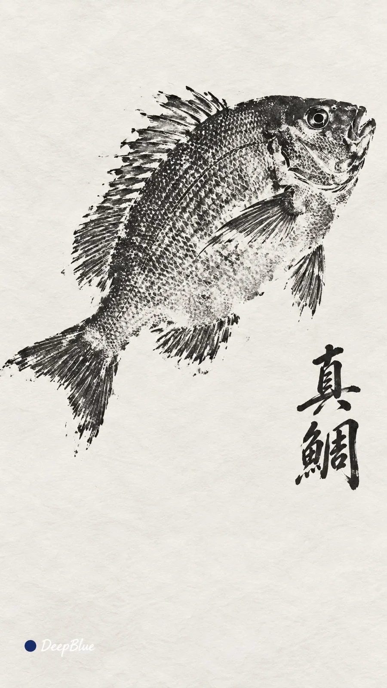

# Japanese Gyotaku Fish Rubbing Series

**中文标题：** 日本鱼拓（Gyotaku）拓印系列  
**ID:** `gi25-x-1011` · **Mode:** `generate`  
**Categories:** `general`, `poster-typography`  
**Tags:** `x-twitter`, `community`, `gpt-image-2.5`, `x-direct`, `zh`



### Japanese Gyotaku Fish Rubbing Series

```text
海洋魚類 × 日本 Gyotaku 傳統直接魚拓 × 黑墨接觸印痕 × 毛筆魚名題款 × 疏朗留白

魚體上墨後覆紙拓印。濃墨與紙白自然交錯，墨量和接觸差異形成不均勻印痕。體表紋理、鰭條與輪廓顯隱不一，局部粘連、缺墨或輕微外溢，保留真實拓印的偶然性。紙面平整乾淨，紙紋輕淡。

留白處小幅手寫主體中文通用名，黑墨毛筆行楷，字距與筆勢自然，位置呼應魚體。

六張各選不同海洋魚類，魚體朝向、尺度、位置與圖文布局各不相同。

9:16，n=6，六張獨立單圖，不拼圖。左下簽名：深藍色實心圓點在前，白色手寫體「DeepBlue」在後。
```

- **Recommended model:** `gpt-image-2.5-sunburst`
- **Settings:** _(defaults)_
- **Source:** [community](https://x.com/DeepBlueX0/status/2113200134850818116) — @DeepBlueX0
- **License note:** Original public X post; quoted with attribution — remix with attribution
- **Notes:** Collected directly from X; original post https://x.com/DeepBlueX0/status/2113200134850818116; post text names GPT Image 2.5; discovered via Bin0754/gpt-image-gallery index, prompt re-verified against the original X post via api.fxtwitter.com; verified=True
- **Preview:** `previews/gi25-x-1011.webp`
