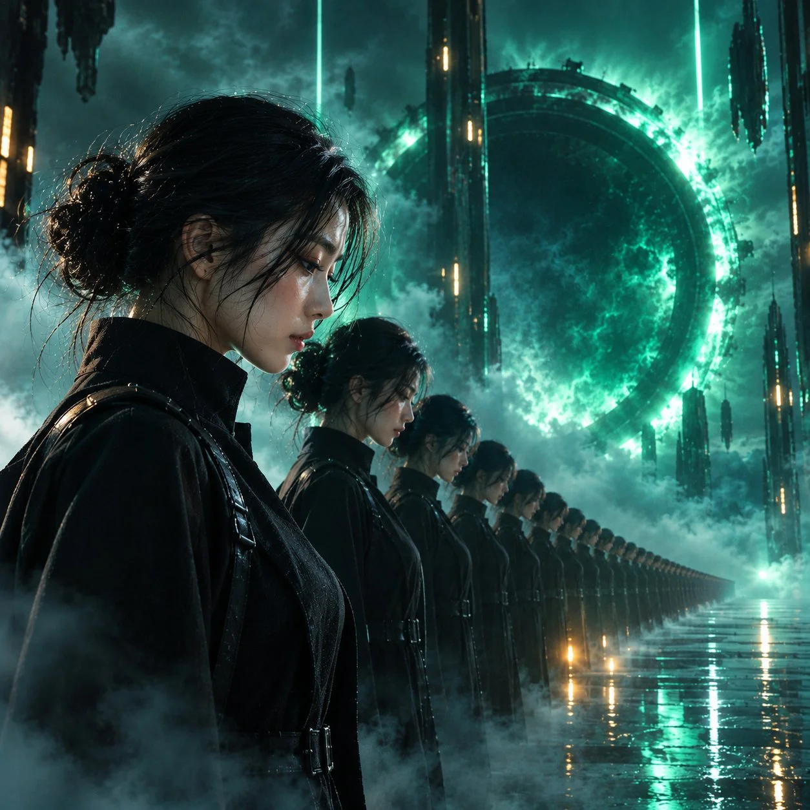

# Sci-Fi Clone Profile Film Still

**中文标题：** 科幻克隆侧影电影剧照  
**ID:** `gi25-x-1012` · **Mode:** `generate`  
**Categories:** `general`  
**Tags:** `x-twitter`, `community`, `gpt-image-2.5`, `x-direct`, `en`



### Sci-Fi Clone Profile Film Still

```text
Create an ultra-detailed, high-quality cinematic sci-fi film still in a 1:1 square aspect ratio.

MAIN SUBJECT: A beautiful young woman standing in the extreme foreground, shown in left-facing side profile, her head slightly lowered and expression calm, mysterious, and confident. She wears a sleek, minimalist black futuristic coat with a high collar. Her dark hair is loosely tied back, with a few natural strands framing her face. Her facial features, skin texture, and hair must look photorealistic and natural.

UNEXPECTED VISUAL: Behind her, an impossibly long, perfectly aligned row of identical versions of the same woman stretches into the distance, each wearing exactly the same black outfit and standing completely motionless. The clones gradually disappear into dense atmospheric fog, creating an eerie sense of infinite repetition.

ENVIRONMENT: A colossal circular portal dominates the background, glowing with intense emerald green and icy cyan light. Towering futuristic monoliths and thin vertical neon light pillars rise through the darkness. The ground is wet, glossy black stone, reflecting the portal and scattered amber lights. Thick rolling fog flows around the subjects' legs and across the reflective floor.

LIGHTING & CAMERA: Dramatic cyan-green volumetric light rays, strong rim lighting outlining the woman's silhouette, deep cinematic shadows, subtle amber highlights, realistic skin pores, fine hair details, rich blacks, controlled highlights, shallow depth of field, and atmospheric perspective. The foreground woman is razor-sharp while the distant clones progressively soften into the mist.

VISUAL STYLE: Premium Hollywood dystopian sci-fi, photorealistic cinematic photography, sophisticated color grading, realistic materials, subtle film grain, powerful composition, surreal scale, mysterious atmosphere, and breathtaking visual depth.

COMPOSITION: The foreground woman occupies the left third of the square frame. The line of clones creates a strong diagonal leading toward the enormous glowing portal in the background. Every clone has consistent facial identity, anatomy, clothing, and proportions.

QUALITY CONTROL: No distorted faces, duplicate body parts, extra limbs, malformed hands, inconsistent outfits, floating objects, random characters, text, logos, watermarks, excessive neon saturation, or artificial plastic skin. Every element must feel intentional, coherent, and visually believable
```

- **Recommended model:** `gpt-image-2.5-sunburst`
- **Settings:** _(defaults)_
- **Source:** [community](https://x.com/Just_Anika_Here/status/2113126775178088582) — @Just_Anika_Here
- **License note:** Original public X post; quoted with attribution — remix with attribution
- **Notes:** Collected directly from X; original post https://x.com/Just_Anika_Here/status/2113126775178088582; post text names GPT Image 2.5; discovered via Bin0754/gpt-image-gallery index, prompt re-verified against the original X post via api.fxtwitter.com; verified=True
- **Preview:** `previews/gi25-x-1012.webp`
