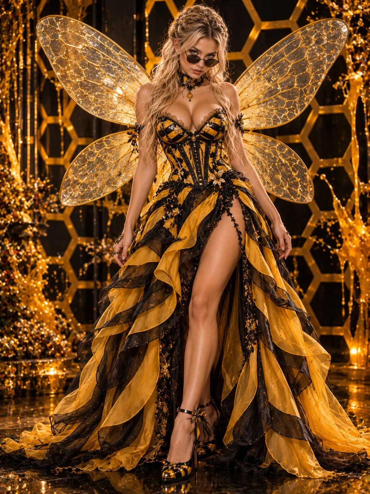

# Queen Bee High-Fashion Fantasy Gown

**中文标题：** 女王蜂高定幻想礼服大片  
**ID:** `gi25-x-1015` · **Mode:** `generate`  
**Categories:** `general`  
**Tags:** `x-twitter`, `community`, `gpt-image-2.5`, `x-direct`, `en`



### Queen Bee High-Fashion Fantasy Gown

```text
Style: Ultra-realistic 8K, vertical 3:4, high-fashion fantasy editorial photography.

Body Pose: Standing confidently, one leg slightly forward through the gown slit, arms relaxed beside the body.

Face Pose: Chin slightly lowered, mysterious expression, gaze toward the camera behind dark sunglasses.

Hair: Platinum-blonde voluminous waves, half-up braided hairstyle.

Outfit: Black-and-golden-yellow bee-inspired evening gown, fitted corset bodice, striped flowing high-low skirt with thigh slit, sheer layered fabric, elegant black-and-yellow heels, jeweled choker.

Wings: Four oversized translucent fairy wings, iridescent honeycomb veins, delicate golden shimmer.

Scene: Yellow-and-black honeycomb-patterned backdrop, abstract honey splashes, luxury fantasy fashion studio.

Lighting: Dramatic studio lighting, golden highlights, realistic wing reflections, crisp shadows.

Quality: Photorealistic skin, detailed embroidery, realistic fabric textures, cinematic depth, professional fashion photography.

Negative Prompt: Cartoon, anime, CGI, plastic skin, blur, bad anatomy, deformed hands, extra fingers, extra limbs, asymmetrical wings, distorted dress, unnatural proportions, text, watermark.
```

- **Recommended model:** `gpt-image-2.5-sunburst`
- **Settings:** _(defaults)_
- **Source:** [community](https://x.com/antrospike/status/2113660625809514538) — @antrospike
- **License note:** Original public X post; quoted with attribution — remix with attribution
- **Notes:** Collected directly from X; prompt posted as the author's reply https://x.com/antrospike/status/2113660625809514538 to https://x.com/antrospike/status/2113660621913039336, which carries the images and names GPT Image 2.5; discovered via Bin0754/gpt-image-gallery index, prompt re-verified against the original X post via api.fxtwitter.com; verified=True
- **Preview:** `previews/gi25-x-1015.webp`
