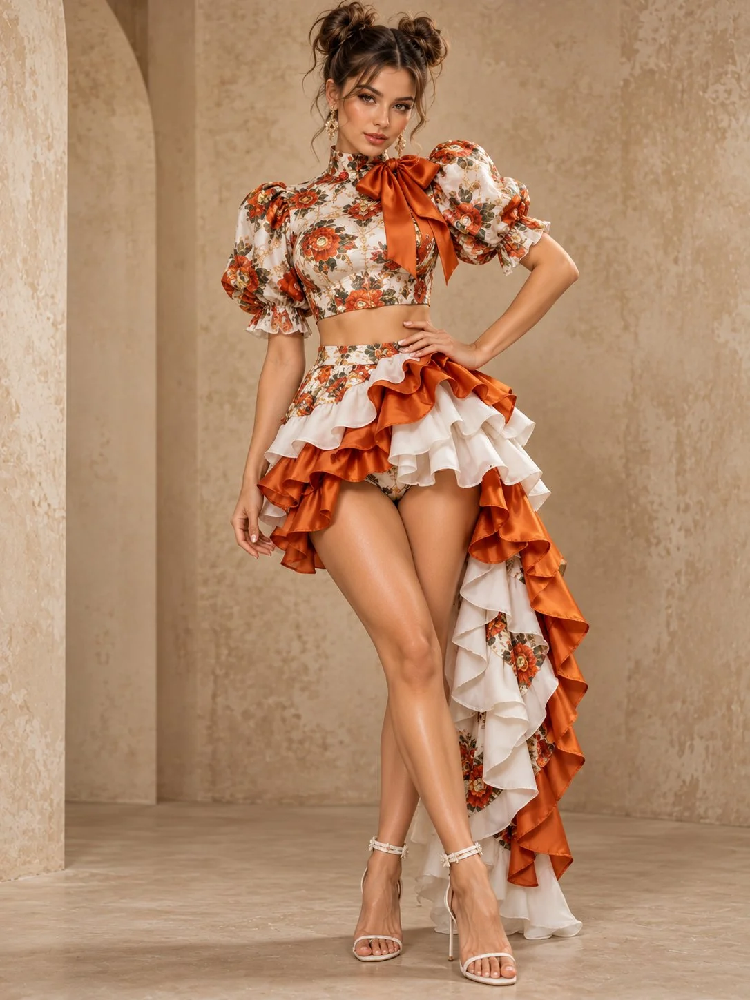

# Layered Outfit High-Fashion Editorial

**中文标题：** 层叠穿搭高级时尚大片  
**ID:** `gi25-x-1016` · **Mode:** `generate`  
**Categories:** `general`  
**Tags:** `x-twitter`, `community`, `gpt-image-2.5`, `x-direct`, `en`



### Layered Outfit High-Fashion Editorial

```text
Style: Ultra-realistic 8K, vertical 3:4, professional high-fashion editorial photography.

Body Pose: Standing with one hand on hip, other arm relaxed, legs elegantly crossed, full-body pose.

Face Pose: Head slightly tilted, confident expression, direct eye contact.

Hair: Brown hair styled in two voluminous messy buns with loose wispy strands.

Outfit: Floral high-neck crop top with puff sleeves and oversized bow, asymmetrical mini skirt with dramatic white and burnt-orange ruffles, white strappy high heels, elegant dangling earrings.

Scene: Minimalist beige studio backdrop with subtle textured plaster walls and soft neutral tones.

Lighting: Soft diffused studio light, gentle shadows, realistic fabric folds.

Quality: Photorealistic skin texture, intricate floral patterns, detailed satin ruffles, luxury fashion magazine aesthetic.

Negative Prompt: Cartoon, anime, CGI, plastic skin, blur, bad anatomy, deformed hands, extra fingers, extra limbs, distorted clothing, unnatural proportions, text, watermark.
```

- **Recommended model:** `gpt-image-2.5-sunburst`
- **Settings:** _(defaults)_
- **Source:** [community](https://x.com/antrospike/status/2113673052332458384) — @antrospike
- **License note:** Original public X post; quoted with attribution — remix with attribution
- **Notes:** Collected directly from X; prompt posted as the author's reply https://x.com/antrospike/status/2113673052332458384 to https://x.com/antrospike/status/2113673051334148151, which carries the images and names GPT Image 2.5; discovered via Bin0754/gpt-image-gallery index, prompt re-verified against the original X post via api.fxtwitter.com; verified=True
- **Preview:** `previews/gi25-x-1016.webp`
