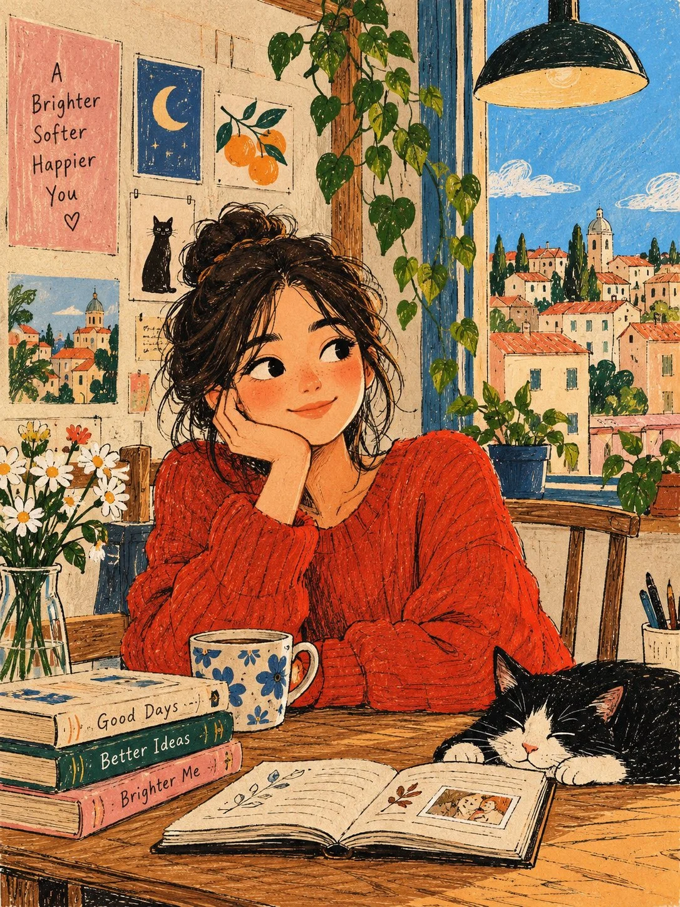

# Original Modern Naïve Art Designer Poster

**中文标题：** 原创现代稚拙风设计师海报  
**ID:** `gi25-x-1022` · **Mode:** `generate`  
**Categories:** `general`  
**Tags:** `x-twitter`, `community`, `gpt-image-2.5`, `x-direct`, `en`



### Original Modern Naïve Art Designer Poster

```text
Create an original modern naïve art illustration as a premium designer poster. Feature a charming, whimsical character in a simple everyday setting, with playful proportions, expressive minimal facial features, and an imaginative composition. Use a minimalist hand-drawn aesthetic with imperfect pencil outlines, visible sketch marks, decorative doodles, and soft yet contrasting flat colors. Incorporate subtle paper texture and an authentic handmade feel, like an illustration drawn by an independent contemporary artist. Keep shapes organic, details intentionally imperfect, and the overall design artistic, warm, and visually distinctive. No shadows, gradients, photorealism, or 3D effects. Clean composition, balanced negative space, sophisticated color palette, gallery-worthy editorial design, high-quality print poster aesthetic. Generate the complete artwork from scratch without using or requiring any reference image.
```

- **Recommended model:** `gpt-image-2.5-sunburst`
- **Settings:** _(defaults)_
- **Source:** [community](https://x.com/j_smeaton99/status/2114352687366156785) — @j_smeaton99
- **License note:** Original public X post; quoted with attribution — remix with attribution
- **Notes:** Collected directly from X; original post https://x.com/j_smeaton99/status/2114352687366156785; post text names GPT Image 2.5; discovered via Bin0754/gpt-image-gallery index, prompt re-verified against the original X post via api.fxtwitter.com; verified=True
- **Preview:** `previews/gi25-x-1022.webp`
