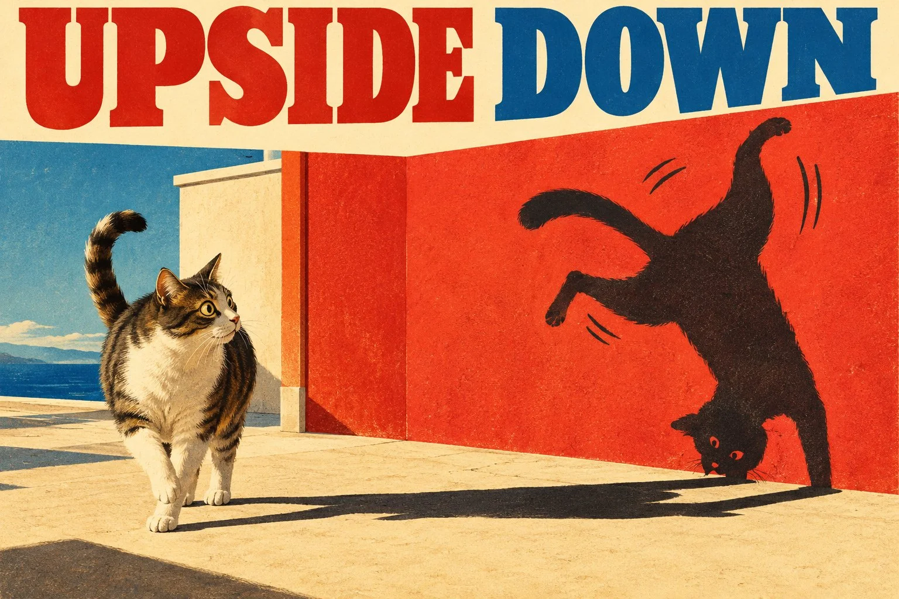

# Mischievous Shadow Surreal Editorial Illustration

**中文标题：** 调皮影子超现实编辑插画  
**ID:** `gi25-x-1025` · **Mode:** `generate`  
**Categories:** `general`, `poster-typography`  
**Tags:** `x-twitter`, `community`, `gpt-image-2.5`, `x-direct`, `en`



### Mischievous Shadow Surreal Editorial Illustration

```text
Create a surreal, humorous 3:2 horizontal editorial illustration titled “[CUSTOM TITLE].”

SUBJECT:
[PERSON / ANIMAL / CHARACTER / OBJECT / CREATURE / PLACE / ANY SUBJECT]

CONCEPT:
Reimagine the chosen subject in a fitting environment where its shadow mysteriously gains a life and personality of its own. The real subject remains natural and recognizable, while its independent shadow embarks on an unexpected, amusing adventure inspired by the subject’s appearance, characteristics, activities, identity, or surroundings.

SHADOW'S ADVENTURE:
Invent one original, visually understandable action that the shadow is performing. It might exaggerate the subject’s usual behavior, pursue an unexpected hobby, or do something the original subject could never normally do. Adapt the idea to the chosen subject rather than following a fixed scenario.

COMPOSITION:
Place the main subject on the left and its oversized, expressive shadow across the ground and a nearby wall on the right. Keep the shadow visually connected to the subject while clearly performing a different action. Use strong directional sunlight, convincing shadow geometry, and a surprised reaction whenever appropriate.

ART STYLE:
Combine 1960s retro advertising illustration with contemporary surreal editorial art. Use bold flat silhouettes, geometric environments, clean graphic shapes, subtle screen-printed paper grain, and clever visual storytelling.

COLOR PALETTE:
Warm ivory, deep black, vermilion red, cobalt blue, and mustard yellow. Crisp sunlight, high contrast, and generous negative space.

PERSONALIZATION:
Adapt the environment, shadow behavior, poses, proportions, and humor to any chosen subject. For subjects without conventional anatomy or natural shadows, creatively reinterpret the concept while preserving their defining characteristics.

TYPOGRAPHY:
Display “[CUSTOM TITLE]” prominently in the upper margin. Use typography that complements the subject and overall composition. No additional text unless specifically requested.

Avoid photorealism, 3D rendering, generic shadow poses, clutter, excessive details, misspelled text, logos, and watermarks.

FORMAT: 3:2 horizontal, high-resolution graphic illustration.
```

- **Recommended model:** `gpt-image-2.5-sunburst`
- **Settings:** _(defaults)_
- **Source:** [community](https://x.com/Goodmanprotocol/status/2113969225740284023) — @Goodmanprotocol
- **License note:** Original public X post; quoted with attribution — remix with attribution
- **Notes:** Collected directly from X; original post https://x.com/Goodmanprotocol/status/2113969225740284023; post text names GPT Image 2.5; discovered via Bin0754/gpt-image-gallery index, prompt re-verified against the original X post via api.fxtwitter.com; verified=True
- **Preview:** `previews/gi25-x-1025.webp`
