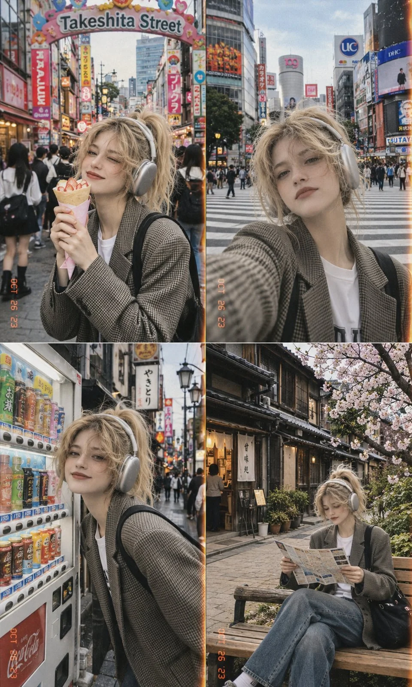

# Tokyo 1990s Disposable-Camera 2×2 Street Collage

**中文标题：** 东京 90 年代一次性相机 2×2 街拍拼贴  
**ID:** `gi25-x-1026` · **Mode:** `generate`  
**Categories:** `general`, `character-consistency`  
**Tags:** `x-twitter`, `community`, `gpt-image-2.5`, `x-direct`, `en`



### Tokyo 1990s Disposable-Camera 2×2 Street Collage

```text
Create a 2×2 collage of four candid, ultra-realistic street photography shots featuring the same stylish young woman exploring Tokyo, Japan, with a nostalgic 1990s disposable film camera aesthetic.

Subject: A beautiful young woman with platinum blonde hair tied in a high ponytail, soft face-framing strands, silver over-ear headphones, and natural makeup. She wears an oversized gray-brown checkered blazer over a white T-shirt, relaxed blue jeans, and carries a black shoulder bag. Maintain consistent facial features, hairstyle, outfit, and accessories across all four photographs.

Top-left panel: The woman stands on Takeshita Street in Harajuku, smiling brightly while holding and eating a Japanese crepe wrapped in paper. A colorful “Takeshita Street” entrance sign, crowded pedestrian street, Japanese storefronts, and busy urban surroundings fill the background.

Top-right panel: A casual arm's-length selfie of the same woman standing at a busy Tokyo pedestrian crossing. She looks directly into the camera with a relaxed expression. Large Japanese commercial buildings, street signs, traffic lights, and white zebra-crossing stripes create an authentic city atmosphere.

Bottom-left panel: The woman smiles playfully beside a Japanese vending machine filled with colorful drinks. She leans slightly toward the camera, with a narrow shopping street, small storefronts, and Japanese signs extending into the background.

Bottom-right panel: The woman sits on a wooden bench along a quiet traditional Japanese shopping street, reading a folded paper map or travel guide. Weathered wooden buildings, small shop entrances, potted greenery, and delicate cherry blossom branches create a peaceful springtime atmosphere.

Photography style: Authentic candid snapshots, slightly imperfect framing, natural body language, soft overcast daylight, subtle motion blur, realistic skin texture, muted colors, warm film grain, faded highlights, gentle shadows, low contrast, and a nostalgic analog camera finish. Add subtle orange date stamps near the bottom edges of the photographs, resembling old 35mm film prints.

Composition: Four equally sized rectangular photographs arranged in a clean 2×2 grid, separated by thin vertical and horizontal borders. Consistent subject identity throughout, documentary-style travel photography, realistic Japanese urban details, natural proportions, and a spontaneous personal travel diary feeling.

Aspect ratio: 3:5 vertical collage.

Avoid: Cartoon styling, illustration, excessive retouching, plastic skin, inconsistent faces, duplicated people, distorted hands, incorrect clothing, artificial lighting, and overly saturated colors.
```

- **Recommended model:** `gpt-image-2.5-sunburst`
- **Settings:** _(defaults)_
- **Source:** [community](https://x.com/Ziha_ai/status/2114262700679471389) — @Ziha_ai
- **License note:** Original public X post; quoted with attribution — remix with attribution
- **Notes:** Collected directly from X; original post https://x.com/Ziha_ai/status/2114262700679471389; post text names GPT Image 2.5; discovered via Bin0754/gpt-image-gallery index, prompt re-verified against the original X post via api.fxtwitter.com; verified=True
- **Preview:** `previews/gi25-x-1026.webp`
