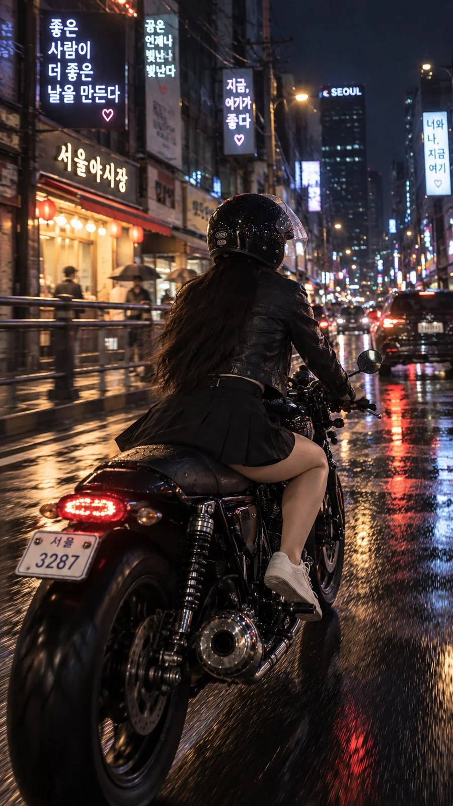

# Rainy Seoul Night Café-Racer Rider

**中文标题：** 雨夜首尔咖啡骑士摩托人像  
**ID:** `gi25-x-1031` · **Mode:** `generate`  
**Categories:** `general`  
**Tags:** `x-twitter`, `community`, `gpt-image-2.5`, `x-direct`, `en`



### Rainy Seoul Night Café-Racer Rider

```text
Photorealistic vertical 9:16 photograph of a young Korean woman in her early 20s riding a sleek black café-racer motorcycle through a rain-slicked Seoul backstreet at night. She sits naturally on the bike, wearing a fitted dark leather jacket over a simple white tank top, a stylish short black skirt, and clean white sneakers. Long straight black hair flows from under a half-open helmet as she glances back over her shoulder toward the camera with a calm, slightly mischievous expression. Neon shop signs in Hangul reflect across the wet asphalt, steam rises from a nearby food stall, and warm streetlights mix with cool blue and pink neon glow. Realistic skin texture, natural proportions, subtle motion blur in the background, candid smartphone-style framing, cinematic rainy-night atmosphere, highly detailed, photorealistic.
```

- **Recommended model:** `gpt-image-2.5-sunburst`
- **Settings:** _(defaults)_
- **Source:** [community](https://x.com/MrDasCreates/status/2113980547483812218) — @MrDasCreates
- **License note:** Original public X post; quoted with attribution — remix with attribution
- **Notes:** Collected directly from X; original post https://x.com/MrDasCreates/status/2113980547483812218; post text names GPT Image 2.5; discovered via Bin0754/gpt-image-gallery index, prompt re-verified against the original X post via api.fxtwitter.com; verified=True
- **Preview:** `previews/gi25-x-1031.webp`
