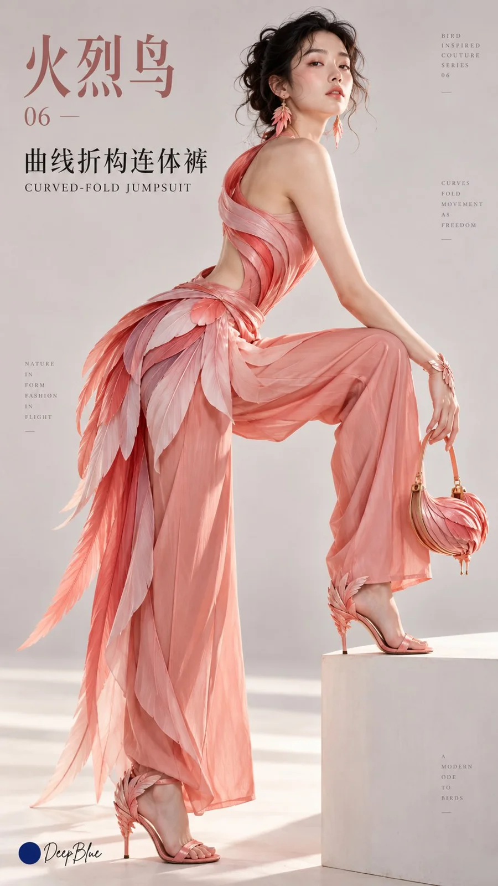

# Bird-Mimicry Concept Fashion Lookbook Series

**中文标题：** 鸟类拟态概念时装 Lookbook 系列  
**ID:** `gi25-x-1040` · **Mode:** `generate`  
**Categories:** `general`  
**Tags:** `x-twitter`, `community`, `gpt-image-2.5`, `x-direct`, `zh`



### Bird-Mimicry Concept Fashion Lookbook Series

```text
鸟类拟态 × 概念时装 × Lookbook × 极简主义 Fashion Editorial

将十种鸟类的外形、羽翼与体态转译为十套服饰及完整造型。人物保留人类面容与身体，通过服饰延伸人体轮廓，形成鲜明的人鸟融合形象。

1. 孔雀 ×《展屏结构礼服》× FAN-STRUCTURE GOWN
    放射状裙撑连接腰背，撑起扇形裙面，蓝绿虹彩与眼状纹沿骨架展开。人物背向镜头回头，展示展屏轮廓。
2. 燕子 ×《分尾剪裁套装》× FORKED-TAIL SUIT
    黑蓝尖翼轮廓融入肩臂剪裁，深叉后摆呼应燕尾。人物迈步转身，带动后摆。
3. 丹顶鹤 ×《长颈立领长裙》× HIGH-COLLAR COLUMN DRESS
    修长立领与纵向剪裁延伸身体比例，黑白分区，领部朱红点缀。人物侧身缓步，颈肩舒展。
4. 猫头鹰 ×《面盘围领斗篷》× FACIAL-DISC CAPE
    面盘的同心层次转译为环绕式围领，棕灰斑纹覆盖圆阔斗篷。人物坐在矮凳上，身体微前倾，斗篷自然垂落。
5. 翠鸟 ×《流线拼接套装》× STREAMLINED PANEL SUIT
    紧凑流线剪裁结合后掠肩部裁片，蓝背橙腹形成色彩分区。人物俯身系鞋，呈现肩背线条。
6. 火烈鸟 ×《曲线折构连体裤》× CURVED-FOLD JUMPSUIT
    S形曲线贯穿单肩上身，腰胯折叠结构连接粉橘色长裤。人物侧身跨上矮台，展现屈腿时的服装形态。
7. 天鹅 ×《弧翼围裹婚纱》× WING-WRAP BRIDAL GOWN
    白色弧形裁片从背部延伸并围裹躯干，领肩曲线呼应天鹅曲颈。人物轻抬双臂，裁片随动作舒展。
8. 鹦鹉 ×《叠片披翼套装》× LAYERED-WING SET
    彩色柔性裁片按羽区覆叠，沿肩臂形成披翼轮廓，弯喙曲线融入扣件。人物侧坐，单臂搭在椅背上，展示叠片层次。
9. 游隼 ×《收翼折构风衣》× FOLDED-WING TRENCH
    后掠肩线与折叠侧片呼应收翼体态，收束腰侧形成紧凑轮廓，蓝灰底色配横斑细节。人物迎风跨步，衣摆向后展开。
10. 企鹅 ×《鳍袖绗缝夹克》× FLIPPER-SLEEVE QUILTED JACKET
    扁平鳍形袖连接紧凑绗缝衣身，黑背白腹分区，轮廓圆润。人物正面站立，双臂自然离开身体，呈现袖形。

每套突出不同的拟态造型，通过剪裁、折叠、围裹与层叠体现鸟类特征，减少羽毛堆叠。面料、支撑与连接方式合理，保留穿着和活动空间。搭配同主题鞋履、手袋与首饰，配饰选择性呼应，避免全部做成鸟形。

十张使用面容与发型明显不同的成年女性模特，沙漏型身材，身形高挑。抓拍试装与活动瞬间，人物专注当下动作，保留自然肤质与衣料状态。

正面、侧面、背面及斜侧机位交错，改变拍摄高度与人物位置，完整呈现服装与鞋履。手袋按动作需要佩戴或放置。

简洁背景、适量留白，突出服装轮廓与拟态细节。每张加入对应鸟类中文名、系列编号、中文主标题及英文副标题，文字随构图变化，避开服饰重点。十张保持统一视觉语言，布局各有差异。

9:16，n=10，十张独立单图，每张一种鸟类、一套完整服饰，不拼图。

左下签名：深蓝色实心圆点在前，空一格，白色手写体「DeepBlue」在后。
```

- **Recommended model:** `gpt-image-2.5-sunburst`
- **Settings:** _(defaults)_
- **Source:** [community](https://x.com/DeepBlueX0/status/2113505853131391373) — @DeepBlueX0
- **License note:** Original public X post; quoted with attribution — remix with attribution
- **Notes:** Collected directly from X; original post https://x.com/DeepBlueX0/status/2113505853131391373; post text names GPT Image 2.5; discovered via Bin0754/gpt-image-gallery index, prompt re-verified against the original X post via api.fxtwitter.com; verified=True
- **Preview:** `previews/gi25-x-1040.webp`
