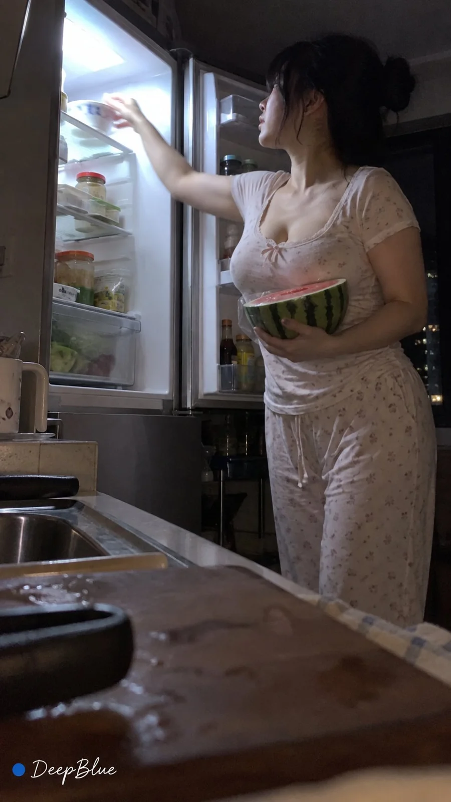

# Late-Night Fridge Raid iPhone Snapshot Series

**中文标题：** 深夜开冰箱找吃的 iPhone 直出系列  
**ID:** `gi25-x-1044` · **Mode:** `generate`  
**Categories:** `general`  
**Tags:** `x-twitter`, `community`, `gpt-image-2.5`, `x-direct`, `zh`



### Late-Night Fridge Raid iPhone Snapshot Series

```text
深夜住宅厨房 × 成年女性开冰箱找食物 × 夏日休閒睡衣 × iPhone 原相机直出

人数、站位、动作、表情与机位自由变化，涵盖翻找、取食、停顿及自然互动；视角可来自冰箱内外，距离、高低、遮挡、裁切与反射灵活变化，同批主要构图不重复。

冰箱食品与厨房杂物自然变化，每张仅突出少量物品，偶有轻微荒诞但合理的细节。

冰箱冷白光主导，环境昏暗，手机自动曝光，偶有局部过曝、轻微运动模糊、噪点与压缩痕迹，保留生活偶然感。

9:16，n=10，独立单图，不拼图。左下签名：深蓝色实心圆点在前，白色手写体“DeepBlue”在后。
```

- **Recommended model:** `gpt-image-2.5-sunburst`
- **Settings:** _(defaults)_
- **Source:** [community](https://x.com/DeepBlueX0/status/2113081373011689550) — @DeepBlueX0
- **License note:** Original public X post; quoted with attribution — remix with attribution
- **Notes:** Collected directly from X; original post https://x.com/DeepBlueX0/status/2113081373011689550; post text names GPT Image 2.5; discovered via Bin0754/gpt-image-gallery index, prompt re-verified against the original X post via api.fxtwitter.com; verified=True
- **Preview:** `previews/gi25-x-1044.webp`
