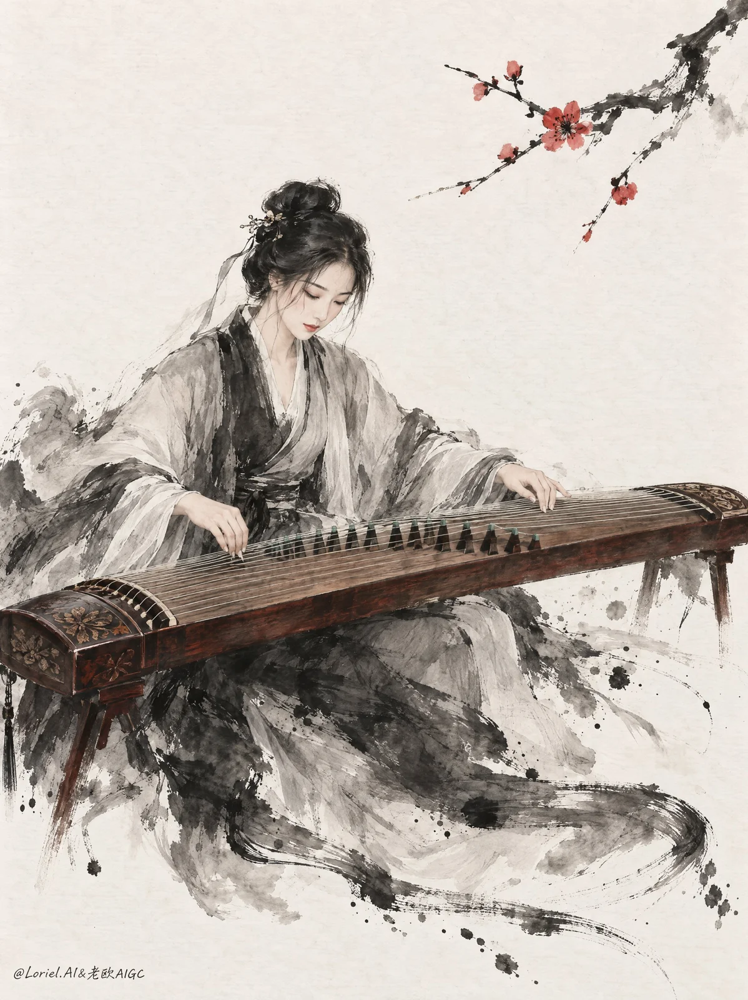

# Guzheng Player Chinese Ink-Wash Figure Painting

**中文标题：** 古筝演奏者水墨人物画  
**ID:** `gi25-x-1046` · **Mode:** `generate`  
**Categories:** `general`  
**Tags:** `x-twitter`, `community`, `gpt-image-2.5`, `x-direct`, `en`



### Guzheng Player Chinese Ink-Wash Figure Painting

```text
A vertical classical Chinese ink-and-wash figure painting of an adult guzheng player, rendered in a refined xieyi-and-gongbi hybrid language: spontaneous black ink washes, dry-brush sweeps, selective fine-line facial and hand definition, restrained mineral accents, and a large untouched rice-paper field. The image should feel like a live musical gesture caught in brush form, elegant and airy rather than decorative or illustrative.

Medium full-figure composition, slightly elevated frontal three-quarter view. The seated woman occupies the center-left core, while the guzheng runs diagonally across the lower frame from left foreground to right midground. A plum branch with blossoms enters from the upper right and bends inward as the upper counterweight. The upper-left and lower-right paper field remain mostly open.

The main structure is the diagonal counterpoint between instrument and flowering branch. The guzheng is the lower dominant axis, the blossom branch the upper accent, and the performer the living hinge between them. Ink splash and brush-tail motion around the sleeves and lower hem extend outward like sound traces, but taper before overwhelming the negative space. The composition should feel asymmetrical, suspended, and rhythmically balanced.

An adult East Asian woman with mature delicate features, soft oval face, black hair loosely pinned in a classical updo with a few free strands, wearing layered Han-style robes in smoke grey, pale ash, and soft black ink tones. The robe is expressed mostly through wet-brush mass, diluted wash, and broken ink edges rather than textile realism. The guzheng is polished reddish-brown wood with carved end panels, pale strings, dark bridges, and small cool green bridge accents. The plum blossoms are red-crimson with black centers and only a limited number of buds.

She is mid-performance, torso turned gently toward the strings, one hand hovering in a plucking gesture while the other presses tension into the string bed. Her head leans slightly down, gaze softened toward the instrument, expression calm and inward. The feeling should be that music is already resonating through the body, not that she is posing.

The guzheng and performer form one connected mass. The plum branch sits behind and above the head and shoulder line, framing the figure without competing. Ink motion gathers around the seated lower body and sleeves, then thins into a few long brush arcs and scattered drops. The open paper field remains an active structural counterweight.

No detailed room or landscape. The background is mostly warm-white paper with faint wash residue and a few soft grey ink blooms near the figure’s lower half. Depth comes from overlap, tonal density, and the diagonal recession of the guzheng, not from realism or built environment.

Palette: warm paper white, layered smoke grey, deep black ink, dark lacquered wood, and red blossom accents as the main chromatic peak. The guzheng wood should be slightly darker and richer, giving more weight to the lower axis. The blossoms should be fewer but more decisive, punctuating the upper-right field with concentrated red notes. Keep the face, hands, and top plane of the instrument slightly cleaner and lighter than the surrounding robe ink.

Use wet-edge bloom, dry-brush breakage, soft bleed, scattered splatter, and partially dissolved robe contours. Keep the finest precision in the face, fingers, string alignment, bridge rhythm, and blossom petals. The guzheng wood should feel solid, lacquered, and hand-painted rather than photoreal. The lower robe and surrounding ink traces may abstract into sound-like brush energy, but the seated balance and instrument contact must remain readable.

Vertical full-bleed composition. No text, no calligraphy, no seal, no logo, no decorative border. The image must synthesize three priorities at once: stronger motion in the lower ink-swept robe and brush trails, a more restrained blossom count with deeper instrument wood tone, and a slightly more abstract resonance pattern around the performer while preserving the core relation between adult musician, guzheng, and plum branch.

Avoid extra fingers, fused fingers, broken wrists, twisted forearms, incorrect string contact, warped guzheng perspective, duplicated limbs, childlike proportions, unstable seated posture, photoreal rendering, anime simplification, glossy CGI surfaces, hard digital gradients, over-sharpening, thick oil-paint texture, overcrowded blank paper field, symmetrical layout, excessive blossoms, background scenery, random props, plastic-looking wood, neon red flowers, muddy grey washes, dead black blobs, or vector-like outlines.
```

- **Recommended model:** `gpt-image-2.5-sunburst`
- **Settings:** _(defaults)_
- **Source:** [community](https://x.com/ou_zhen599/status/2112856622942855434) — @ou_zhen599
- **License note:** Original public X post; quoted with attribution — remix with attribution
- **Notes:** Collected directly from X; original post https://x.com/ou_zhen599/status/2112856622942855434; post text names GPT Image 2.5; discovered via Bin0754/gpt-image-gallery index, prompt re-verified against the original X post via api.fxtwitter.com; verified=True; original post compares GPT Image 2.5 (left) with Nano Banana 2.1 (right) on the same prompt
- **Preview:** `previews/gi25-x-1046.webp`
