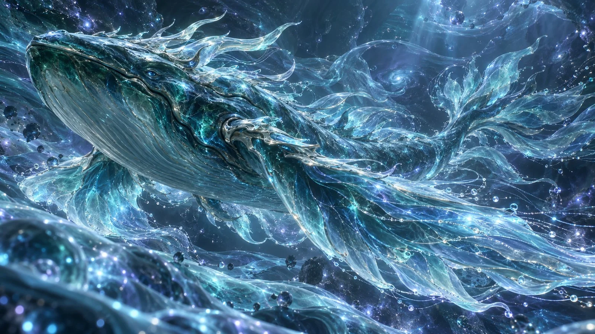

# Star-Sea Mythical Whale 3D CG Concept Poster

**中文标题：** 星海幻鲸 3D CG 概念海报  
**ID:** `gi25-x-1048` · **Mode:** `generate`  
**Categories:** `general`  
**Tags:** `x-twitter`, `community`, `gpt-image-2.5`, `x-direct`, `zh`



### Star-Sea Mythical Whale 3D CG Concept Poster

```text
【画幅与核心风格】
16:9 横版，高精度风格化 3D CG 东方幻想神兽概念海报，cinematic oriental fantasy 3D CG，ethereal fluid fantasy art，abstract elemental energy，cinematic mythical creature render，high-end fantasy concept art。
画面采用高完成度三维神兽建模、超现实流体模拟、精细半透明材质、电影级光影与史诗级空间构图，呈现神秘、恢宏、空灵而极具视觉震撼力的东方幻想奇观。
【主题身份与整体气质】
画面主体是一只游弋于远古虚空潮汐中的东方幻想神兽——「归墟玄鲲」。
它是诞生于原初深海与无尽虚空之间的古老神性生命，拥有超越现实鲸类的庞大体型，能够在没有海水的抽象能量空间中自由游动。它的身体既包含真实而精密的三维生物结构，也由流动的灵玉、透明琉璃、液态能量与无数细密光丝构成。
整体气质古老、神圣、沉静、深邃、优雅而神秘。它仿佛已经穿越千万年的时间，缓慢游过一片没有边界的宇宙潮汐领域，拥有极其强烈的远古神兽生命感与东方神话史诗气质。
【主体形态与核心识别特征】
归墟玄鲲拥有山岳般巨大的头部、宽阔而流畅的流线型躯干，以及夸张延长的双翼状胸鳍。
头部体积厚重而饱满，轮廓参考深海巨鲸的自然流线结构，并融入原创东方幻想生物设计。前额宽阔，鼻吻部自然收束，眼部较小而深邃，具有宁静且富有灵性的神兽神情。
头部两侧与上方生长着数道半透明深海灵角，灵角形态修长、柔和弯曲，仿佛由海底灵玉与透明液态晶体自然凝结而成，内部存在缓慢流动的青蓝色发光脉络。
双翼状胸鳍极其宽阔，从身体两侧自然延伸，形成如同巨大海翼般的流畅轮廓。鳍翼根部具有厚实、清晰的三维生物结构，越接近外缘越轻盈透明，逐渐延展成大量细长的液态流体薄膜与发光能量丝。
背部轮廓厚重优美，具有连续起伏的生物曲线。身体向后逐渐收束，尾部延展为多层分叉尾鳍，各层尾鳍具有不同长度、弯曲方向和透明程度，形成富有节奏感的飘逸轮廓。
整个主体必须具有完整、协调且具有独创性的神兽解剖结构，呈现真实的三维体积与重量感。
【半实体化材质结构】
归墟玄鲲主体由深海青玉、半透明蓝绿琉璃、液态水晶与高精度光学薄膜共同构成。
头部和躯干核心区域保留相对坚实的深青玉质结构，表面光滑细腻，具有丰富的矿物纹理、自然起伏和柔和的镜面反射。玉质表层下方隐约可见复杂的生物能量脉络，呈现真实的材质厚度与内部层次。
胸鳍与尾鳍由半透明蓝绿琉璃向液态水晶逐渐过渡，鳍膜具有精致的厚薄变化、液态折射、边缘透光与真实的空间弯曲。
巨大的鳍翼从靠近身体的稳定实体结构，逐渐转化成柔软的透明能量薄膜，再延展为无数细密的发光丝线与微小悬浮粒子。
实体与非实体之间保持自然连续的转换关系，使神兽仿佛正在与整个虚空潮汐融为一体。
【核心流体与粒子特效】
围绕归墟玄鲲建立高精度、具有完整空间层次的三级流体能量系统。
第一层，大尺度液态能量：
数道宽阔、柔软而半透明的青蓝色液态能量带，从神兽背部、胸鳍与尾鳍内部自然延伸。
能量带具有真实的液体厚度、透光性、弯曲张力与光学折射，形态如同巨大的透明深海丝绸，在没有重力的虚空中缓慢舒展。
鳍翼边缘的液态流体向后方延展，形成数条巨大而优美的流线型能量弧面。不同能量带相互错位、交叠、穿插，创造丰富而清晰的三维空间深度。
第二层，中尺度精细流光：
成千上万根极细的青蓝色生物荧光丝线沿神兽背部、鳍翼骨架与半透明鳍膜自然分布。
光丝从神兽体内能量脉络中产生，沿鳍翼结构向外延伸，在透明液态薄膜内部形成复杂、精密而富有秩序的流光网络。
部分光丝沿宽阔的S形曲线缓慢流动，部分围绕鳍翼末端轻柔盘旋，部分自然分离并向后方延伸成细长的光学轨迹。
光丝在不同深度交错排列，粗细、亮度、密度具有自然变化，形成精致而富有生命感的流体层次。
第三层，微观粒子细节：
大量极细小的青蓝色发光微粒、蓝紫色晶体碎屑、透明水晶微滴与细密星砂漂浮在神兽周围。
靠近鳍翼边缘的粒子相对密集，向远方逐渐稀疏，呈现自然的粒子消散效果。
极少量明亮的微观荧光点穿插于深色空间之中，丰富细节但不形成杂乱光污染。
【动态与能量运动】
归墟玄鲲正以极其缓慢、庄严而优雅的姿态向前游动。
巨大的头部保持稳定，身体具有轻微自然起伏，双翼状胸鳍以舒缓的节奏向外展开，仿佛在无形的虚空潮汐中轻轻划动。
鳍翼边缘的透明液态能量受到运动牵引，向身体后方连续延展，形成宽阔而柔和的流体尾迹。
青蓝色能量脉络沿背部和胸鳍向外传导，使整个身体呈现缓慢呼吸般的能量律动。
神兽经过的空间中产生层层透明的潮汐涟漪，涟漪向周围缓慢传播，与悬浮能量薄膜相互交织。
整体运动节奏宁静、连贯、柔和，体现远古庞然巨物所特有的从容感。
【抽象东方幻想场景】
背景是一片深邃、辽阔而没有明确边界的青黑色抽象潮汐虚空。
空间中不存在真实海面、海底、山川或地平线，而是由半透明流体薄膜、柔和能量烟雾、抽象潮汐波纹与微小星砂构成的神秘精神领域。
远处悬浮着层层巨大的透明流体结构，它们如同缓慢变化的空间褶皱，形成深浅交错的抽象层次。
深青黑色虚空向远处逐渐变暗，局部存在极其微弱的蓝紫色星砂与低亮度能量脉络，营造无尽空间的神秘感。
背景中的流体变化与归墟玄鲲的游动形成能量呼应，但背景始终保持克制，突出神兽的巨大轮廓、半透明鳍翼与核心发光结构。
【构图视角与巨大尺度】
16:9 横向史诗构图，采用远距离侧前方广角仰视的空间透视关系。
镜头位于神兽前方偏下的位置，山岳般巨大的头部处于画面近端，占据显著视觉空间，形成极其强烈的近大远小透视。
巨大的身体沿对角线向画面深处延伸，宽阔胸鳍向左右两侧舒展，部分透明鳍翼超出画面边缘。
后方多层分叉尾鳍逐渐缩小并消失在深邃的抽象虚空之中。
镜头既能够清晰展现神兽近端头部的精致三维细节，又能够通过身体向远方的延伸表现超乎想象的巨大体型。
使用前景透明能量薄膜、中景巨型神兽与远景抽象潮汐结构形成丰富的空间层次。
通过巨大轮廓、透视收缩、局部裁切、远近遮挡与空气透视，呈现仿佛镜头无法容纳整个神兽的史诗级尺度感。
【电影级神性光影】
整体采用高精度电影级三维光照系统。
神兽内部的青蓝色能量脉络作为主要自发光光源，柔和照亮周围的深青玉质表面与透明琉璃结构。
巨大头部受到来自空间上方的柔和冷青色光照，形成具有雕塑感的明暗体积，清晰展示头部、灵角与躯干的立体轮廓。
背部与胸鳍边缘存在精致的青蓝色轮廓光，使半透明鳍翼在深色背景中保持清晰可辨。
液态水晶鳍膜具有真实的内部折射、柔和反射、体积散射与透明叠层效果。
少量蓝紫色微光点缀在远景深处，增加空间层次。
使用适度 volumetric lighting、subsurface scattering、soft bloom、subtle halation、realistic refraction、cinematic global illumination。
高光清澈通透，暗部深邃而具有细节，避免过度泛光与发白的能量效果。
【色彩控制】
主体核心结构以深海青玉色为主，保留自然的深青、墨绿与蓝绿色矿物层次。
胸鳍、尾鳍及周围液态能量采用更加明亮、透明的青蓝色，与较深的实体躯干形成明确的亮度和材质对比。
生物荧光脉络使用明亮但不过曝的浅青色，少量蓝紫色光点分布于空间深处。
背景保持深海黑与青黑色，避免所有区域被同一种蓝色完全覆盖。
整体配色深邃、通透、冷静、高级，保留明确的主体、能量、背景明暗层级。
【CG渲染品质】
high-end stylized 3D CG，cinematic oriental fantasy art，ethereal elemental energy，translucent fluid simulation，procedural particle dynamics，organic energy dissolution，PBR rendering，ray tracing，volumetric lighting，subsurface scattering，translucent reflections，luminous energy strands，micro particle details，epic cinematic composition，ultra-detailed materials，premium fantasy concept art，high-end game cinematic quality。
整体呈现顶级东方幻想游戏过场CG、神话电影视觉概念设计与高端超现实三维数字艺术的完成度。
```

- **Recommended model:** `gpt-image-2.5-sunburst`
- **Settings:** _(defaults)_
- **Source:** [community](https://x.com/liyue_ai/status/2113895951173902514) — @liyue_ai
- **License note:** Original public X post; quoted with attribution — remix with attribution
- **Notes:** Collected directly from X; original post https://x.com/liyue_ai/status/2113895951173902514; post text names GPT Image 2.5; discovered via Bin0754/gpt-image-gallery index, prompt re-verified against the original X post via api.fxtwitter.com; verified=True
- **Preview:** `previews/gi25-x-1048.webp`
