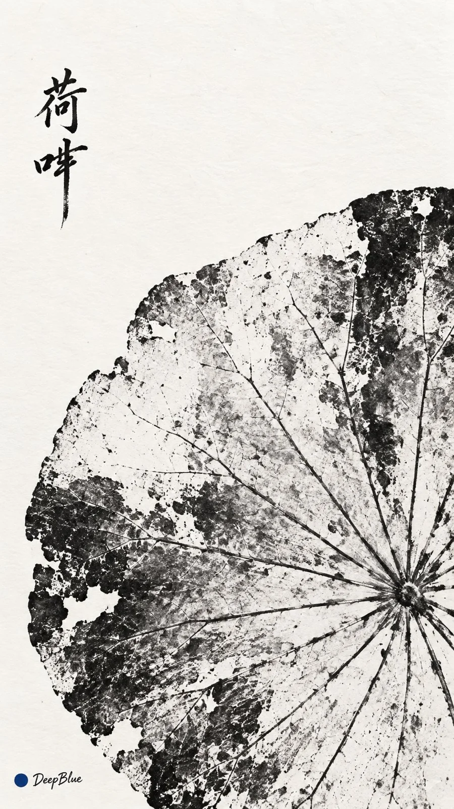

# Botanical Ink Direct Rubbing Series

**中文标题：** 植物黑墨直接拓印系列  
**ID:** `gi25-x-1050` · **Mode:** `generate`  
**Categories:** `general`, `poster-typography`  
**Tags:** `x-twitter`, `community`, `gpt-image-2.5`, `x-direct`, `zh`



### Botanical Ink Direct Rubbing Series

```text
树叶或花朵 × 植物直接拓印 × 黑墨接触印痕 × 毛笔植物名题款 × 疏朗留白

真实叶片或自然压展的花朵上墨后覆纸压印。浓墨与纸白自然交错，纹理与轮廓显隐不一，局部缺墨或粘连，保留自然接触印痕。纸面干净，纸纹轻淡。

留白处小幅手写主体中文通用名，黑墨毛笔行楷，位置呼应主体。

每张独立随机选择树叶或花朵，六张植物种类不重复，朝向、尺度与图文布局各不相同。

9:16，n=6，六张独立单图，不拼图。左下签名：深蓝色实心圆点在前，白色手写体「DeepBlue」在后。
```

- **Recommended model:** `gpt-image-2.5-sunburst`
- **Settings:** _(defaults)_
- **Source:** [community](https://x.com/DeepBlueX0/status/2113200164454510598) — @DeepBlueX0
- **License note:** Original public X post; quoted with attribution — remix with attribution
- **Notes:** Collected directly from X; original post https://x.com/DeepBlueX0/status/2113200164454510598; post text names GPT Image 2.5; discovered via Bin0754/gpt-image-gallery index, prompt re-verified against the original X post via api.fxtwitter.com; verified=True; variant 2 of the author's gyotaku experiment
- **Preview:** `previews/gi25-x-1050.webp`
