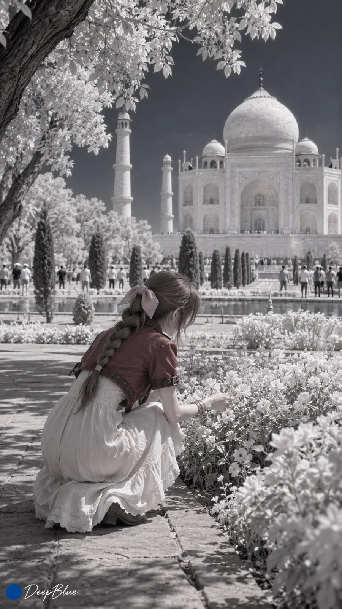

# 720nm Infrared Travel Snapshots with Live-Action Anime Heroines

**中文标题：** 720nm 近红外旅行抓拍：真人化动漫角色  
**ID:** `gi25-x-1055` · **Mode:** `generate`  
**Categories:** `general`  
**Tags:** `x-twitter`, `community`, `gpt-image-2.5`, `x-direct`, `zh`



### 720nm Infrared Travel Snapshots with Live-Action Anime Heroines

```text
720nm近红外摄影 × 真人化动漫或游戏女性角色 × 世界著名旅游景点 × 旅行抓拍

每张随机抽取1至3名不同的知名女性角色，真人化并保留标志性外貌、发型、服饰结构与关键配件。每张搭配一处不同的世界著名旅游景点，人物自然融入真实旅行现场。多人时可自然互动或各自活动，人物位置、距离与遮挡关系随场景变化。

采用720nm近红外摄影经典伪色处理，经自定义白平衡与红蓝通道交换，呈现偏蓝的天空、存在时呈银白的植被，以及有限但清晰的色彩层次。皮肤明亮、低色度，脸、颈部与四肢的近红外响应一致，保留光照造成的自然明暗。服装、头发与建筑的颜色和明暗随近红外响应变化，不强行保留角色原色。人物与环境统一成像，保留真实发丝、织物和建筑材质。

同行朋友随手抓拍，各张独立变化动作、表情、机位、景别与构图。允许路人、遮挡、轻微倾斜和偶然裁切，呈现不刻意摆拍的旅行瞬间。路人不计入1至3名角色的人数。

9:16竖版，n=10，10张独立单图，不拼图。各张重新抽取人数、角色、景点与构图，避免复用姿态和主要构图关系。每张左下角深蓝色实心圆点，空格后接白色手写体“DeepBlue”。
```

- **Recommended model:** `gpt-image-2.5-sunburst`
- **Settings:** _(defaults)_
- **Source:** [community](https://x.com/DeepBlueX0/status/2113653053400445330) — @DeepBlueX0
- **License note:** Original public X post; quoted with attribution — remix with attribution
- **Notes:** Collected directly from X; original post https://x.com/DeepBlueX0/status/2113653053400445330; post text names GPT Image 2.5; discovered via Bin0754/gpt-image-gallery index, prompt re-verified against the original X post via api.fxtwitter.com; verified=True
- **Preview:** `previews/gi25-x-1055.webp`
