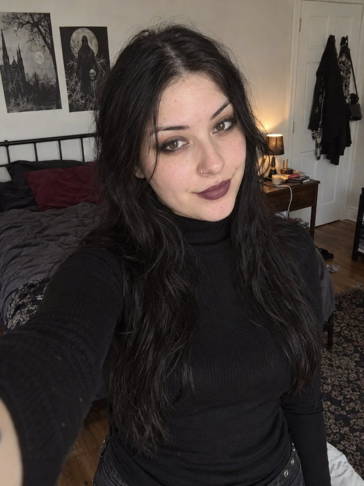

# Casual Goth Ordinary iPhone Selfie

**中文标题：** 日常哥特风 iPhone 前置自拍  
**ID:** `gi25-x-1057` · **Mode:** `generate`  
**Categories:** `general`  
**Tags:** `x-twitter`, `community`, `gpt-image-2.5`, `x-direct`, `en`



### Casual Goth Ordinary iPhone Selfie

```text
A fictional adult woman aged 25 with a casual goth style taking an ordinary iPhone front-camera selfie in her bedroom. An ordinary believable attractive person with individual human features.

Softly rounded oval face, natural medium sized brown eyes with normal iris sizes and slightly hooded upper lids, natural eye spacing, modest uneven eyebrows, a gently rounded nose with believable nostrils, softly defined jaw, natural medium lips, slight asymmetric relaxed half smile.

Realistic skin at normal phone resolution with sparse small imperfections and subtle localized redness, no uniform stippled pore pattern, no etched fuzz or plastic smoothing.

Long loose black hair over both shoulders, slightly untidy part, flyaways, a few very subtle dandruff flakes near roots. Casual dark smoky eyeliner and deep plum lipstick applied imperfectly, small silver nose hoop.

Fully opaque fitted black knit turtleneck with high neck, full chest coverage and long sleeves.

Candid arm length selfie from just above eye level, extended sleeve partly visible lower left, head upright with a small natural tilt, looking into lens. Portrait 3:4 waist-up framing, small handheld camera tilt.

Modest lived-in goth bedroom: off-white walls with a couple unframed monochrome gothic art prints, ordinary black metal bed with rumpled charcoal duvet and burgundy pillow, wooden bedside table with a shaded warm lamp, paperback books and charging cable, a white door and clothes hung on hooks. Plausible modest room proportions, restrained decoration.

Diffuse daylight from off-camera window, warm lamp weak in background, physically consistent face and room illumination.

Normal slightly low-quality iPhone front camera snapshot, modest resolution, gentle optical softness, subtle shadow grain and compression, restrained sharpening, ordinary imperfect exposure and white balance. Face must remain readable but not hyperdetailed; background also naturally readable, no portrait-mode bokeh.

No studio lighting, glamour retouching, cinematic grading, aggressive HDR, waxy skin, excessive grain or heavy blur. Target 1080x1440 portrait.
```

- **Recommended model:** `gpt-image-2.5-sunburst`
- **Settings:** _(defaults)_
- **Source:** [community](https://x.com/bjn1224/status/2113819096882041241) — @bjn1224
- **License note:** Original public X post; quoted with attribution — remix with attribution
- **Notes:** Collected directly from X; original post https://x.com/bjn1224/status/2113819096882041241; post text names GPT Image 2.5; discovered via Bin0754/gpt-image-gallery index, prompt re-verified against the original X post via api.fxtwitter.com; verified=True
- **Preview:** `previews/gi25-x-1057.webp`
