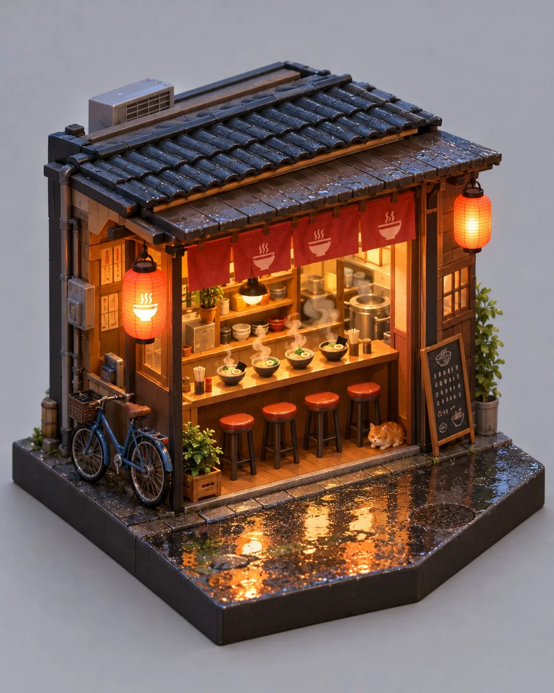

# Isometric Miniature Ramen Shop Diorama

**中文标题：** 等距迷你拉面店模型  
**ID:** `gi25-x-1060` · **Mode:** `generate`  
**Categories:** `general`  
**Tags:** `x-twitter`, `community`, `gpt-image-2.5`, `x-direct`, `en`



### Isometric Miniature Ramen Shop Diorama

```text
Isometric miniature diorama of a tiny nighttime ramen shop, crafted like a detailed collectible toy set on a plain soft-gray studio surface. Cutaway shop box: warm orange interior light, four miniature stools at a narrow counter, steaming bowls with soft vapor curls, tiny chopsticks, a small chalkboard menu with illegible miniature marks (no readable brand names), hanging paper lanterns, a bicycle parked outside the shop front, rain-wet asphalt with puddle reflections, a tiny orange tabby cat under the eaves. Stylized 3D toy/miniature aesthetic, clean plastic and painted wood materials, subtle subsurface glow from interior lamps, shallow depth of field, centered isometric three-quarter view, cheerful cozy mood. No logos, no watermark, no real restaurant brands, no readable English brand text, square-friendly vertical 4:5 composition.
```

- **Recommended model:** `gpt-image-2.5-sunburst`
- **Settings:** _(defaults)_
- **Source:** [community](https://x.com/Alyssa4aicreate/status/2114152038926032952) — @Alyssa4aicreate
- **License note:** Original public X post; quoted with attribution — remix with attribution
- **Notes:** Collected directly from X; original post https://x.com/Alyssa4aicreate/status/2114152038926032952; post text names GPT Image 2.5; discovered via Bin0754/gpt-image-gallery index, prompt re-verified against the original X post via api.fxtwitter.com; verified=True; author credits the idea as inspired by @Framer_X (credit line omitted from the prompt); author says it was made with GPT Image 2.5 on Token360
- **Preview:** `previews/gi25-x-1060.webp`
