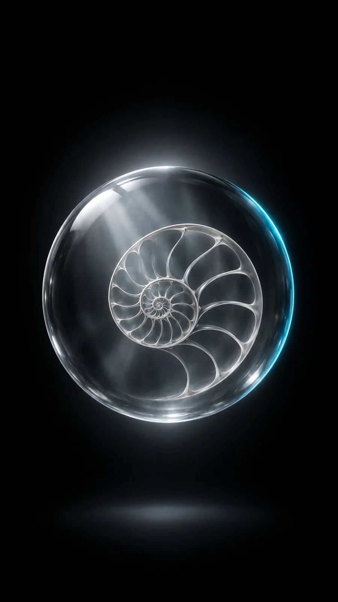

# Glass Orb Fibonacci Lattice Surreal Product Still

**中文标题：** 玻璃球斐波那契晶格超现实静物  
**ID:** `gi25-x-1065` · **Mode:** `generate`  
**Categories:** `general`  
**Tags:** `x-twitter`, `community`, `gpt-image-2.5`, `x-direct`, `en`



### Glass Orb Fibonacci Lattice Surreal Product Still

```text
Clear glass sphere with soft clean specular highlights floating in front of a pure black backplate. Inside the sphere, a delicate nautilus Fibonacci spiral lattice with soft bevels hangs at the center; faint internal haze reveals gentle light shafts. Minimalist surreal photoreal CGI, mostly monochrome grayscale with a single cool cyan rim-light accent tracing the sphere's right edge. Centered eye-level 50mm framing, medium subject scale, calm pristine studio mood, soft backlight halo plus subtle overhead key. No text, no letters, no logos, no watermark, no fingerprints, no heavy caustics, no color clutter beyond the cyan accent. Vertical 9:16, high resolution, abstract product-still aesthetic.
```

- **Recommended model:** `gpt-image-2.5-sunburst`
- **Settings:** _(defaults)_
- **Source:** [community](https://x.com/Alyssa4aicreate/status/2113375253124747600) — @Alyssa4aicreate
- **License note:** Original public X post; quoted with attribution — remix with attribution
- **Notes:** Collected directly from X; original post https://x.com/Alyssa4aicreate/status/2113375253124747600; post text names GPT Image 2.5; discovered via Bin0754/gpt-image-gallery index, prompt re-verified against the original X post via api.fxtwitter.com; verified=True; author credits the idea as inspired by @IamEmily2050 (credit line omitted from the prompt); author says it was made with GPT Image 2.5 on Token360
- **Preview:** `previews/gi25-x-1065.webp`
