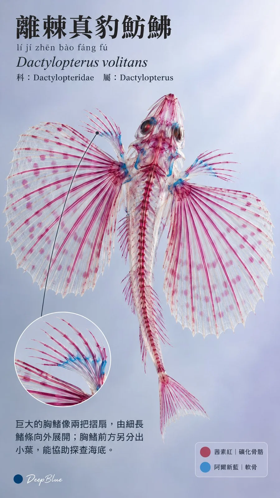

# Cleared-and-Stained Fish Skeleton Natural History Plates

**中文标题：** 透明骨骼鱼类标本自然史图鉴  
**ID:** `gi25-x-1068` · **Mode:** `generate`  
**Categories:** `general`, `poster-typography`  
**Tags:** `x-twitter`, `community`, `gpt-image-2.5`, `x-direct`, `zh`



### Cleared-and-Stained Fish Skeleton Natural History Plates

```text
海洋魚類 × Diaphonization 透明骨骼標本 × 現代自然史圖鑑 × 科普 Editorial

隨機選取10種不同的海洋硬骨魚，每張一件完整標本。各張獨立變化體態、觀看角度、構圖與透光方向，展現不同體形與骨架結構。

軟組織近乎透明，隱約保留體表輪廓與柔軟體積。茜素紅顯示礦化骨骼，阿爾新藍顯示軟骨，染色分布依物種與骨化程度自然變化。骨架符合物種解剖，自然連接。透明甘油浸存質感，透射光顯露精密結構與前後層次，真實微距標本攝影。

沿用統一的圖鑑資訊網格：上方為中文名、斜體拉丁學名與科屬分類；中間完整展示標本；下方以30至50字介紹一個可從圖中觀察的有趣特徵，必要時用纖細引導線對應部位，另附簡短紅藍染色圖例。中文統一使用準確繁體字，名稱、學名、分類與特徵均經核對並對應物種。

中文名採思源宋體風格，說明採思源黑體風格，拉丁學名採西文襯線斜體。名稱含生僻字、易讀錯字或多音字時，在其下方以小字標示完整名稱的漢語拼音，聲調與讀音準確，採清晰無襯線字體，與拉丁學名適度分隔；常見易讀名稱省略拼音。

背景從標本紅藍染色中提取呼應色，降低飽和度、提高明度，形成淡灰藍、灰粉或灰紫等有彩灰色，保留骨架與背景的明暗及色彩差異。標本附近可有極輕微透光漸變，文字區域色調均勻，以深炭色文字保持清晰閱讀。整套背景明度與飽和度接近，色相隨主體變化。

字級層次清晰，文字左對齊，邊距充足，圖文互不遮擋。各張依魚形調整版面，保持整套視覺一致。

9:16豎版，n=10，10張獨立單圖，不拼圖。每張左下角小尺寸深藍色實心圓點，空格後接白色手寫體「DeepBlue」
```

- **Recommended model:** `gpt-image-2.5-sunburst`
- **Settings:** _(defaults)_
- **Source:** [community](https://x.com/DeepBlueX0/status/2113991439319502970) — @DeepBlueX0
- **License note:** Original public X post; quoted with attribution — remix with attribution
- **Notes:** Collected directly from X; original post https://x.com/DeepBlueX0/status/2113991439319502970; post text names GPT Image 2.5; discovered via Bin0754/gpt-image-gallery index, prompt re-verified against the original X post via api.fxtwitter.com; verified=True
- **Preview:** `previews/gi25-x-1068.webp`
