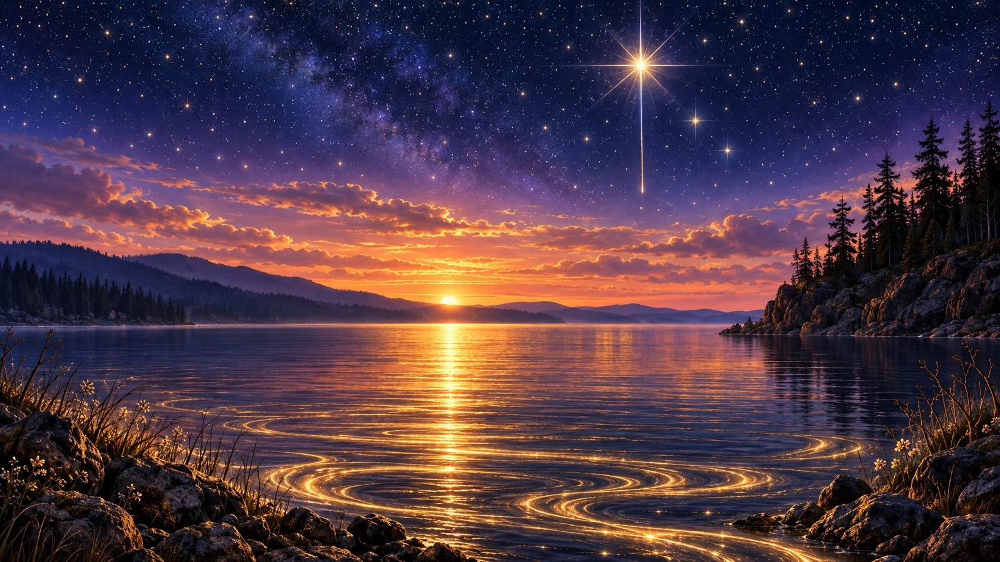

# Painterly Magical Twilight Lake with a Shooting Star

**中文标题：** 流星划过的魔幻暮色湖景绘画  
**ID:** `gi25-x-1074` · **Mode:** `generate`  
**Categories:** `general`  
**Tags:** `x-twitter`, `community`, `gpt-image-2.5`, `x-direct`, `en`



### Painterly Magical Twilight Lake with a Shooting Star

```text
Painterly digital illustration of a magical twilight lake at the meeting of day and night, wide 16:9 panoramic composition, airbrushed smooth gradient rendering, luminous and serene. Edge to edge, no frame, no border, no lettering.

SKY upper: the top two-thirds is deep navy and indigo night, densely scattered with hundreds of fine white and pale gold star pinpoints. One dominant brilliant starburst blazes high right of centre, its core white-hot and its long straight rays fanning far into the dark, with two smaller four-point stars below and beside it. A thin vertical meteor line falls from the main star down toward the horizon.

SKY lower: the night melts downward through violet and lilac into dusky periwinkle, then into a warm band of layered horizontal clouds in apricot, peach, rose and pale amber, their edges outlined with gold rim-light. Above them, faint star specks still drift.

SUN: a small intense white-gold sun disc rests exactly on the horizon line, slightly left of centre, sinking behind the far ridge, its reflection pouring straight down the lake in a long glow.

SHORES: dark pine-forested hills recede on the left as a soft blue-violet silhouette with a gentle shoreline. On the right, a rocky bluff rises, crowned with tall black spruce and pine silhouettes, their trunks and branches sharp against the glow.

WATER: the entire lower third is still black-violet water swept with fine horizontal ripple lines. The sun's light spreads as a wide shimmering gold path across the middle, while the near foreground breaks into long swirling spiral ribbons of glowing golden light, curling and flowing across the surface like liquid threads.

BANKS: rough dark boulders crowd the lower left and lower right corners, edged with thin grass, reeds and small bare twigs, a few tiny pale flowers catching the glow.

PALETTE: deep indigo, navy, violet, lilac, apricot, warm gold, pale white, near-black pine. Smooth gradient blending, glowing highlights, dreamlike and tranquil, clean and unlettered.
```

- **Recommended model:** `gpt-image-2.5-sunburst`
- **Settings:** _(defaults)_
- **Source:** [community](https://x.com/churvikv/status/2114771358823358914) — @churvikv
- **License note:** Original public X post; quoted with attribution — remix with attribution
- **Notes:** Collected directly from X; original post https://x.com/churvikv/status/2114771358823358914; post text names GPT Image 2.5; discovered via Bin0754/gpt-image-gallery index, prompt re-verified against the original X post via api.fxtwitter.com; verified=True; author says it was created on ImagineArt with GPT Image 2.5 Sunburst
- **Preview:** `previews/gi25-x-1074.webp`
