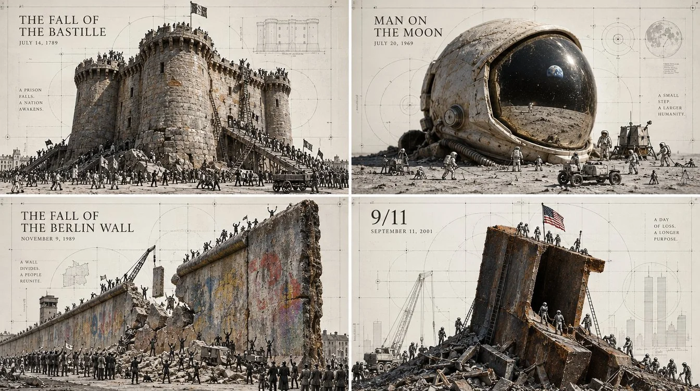

# 2×2 Museum Tiny-Civilization Historic Days Grid

**中文标题：** 2×2 博物馆微缩文明·改变历史的日子  
**ID:** `gi25-x-1080` · **Mode:** `generate`  
**Categories:** `general`, `poster-typography`  
**Tags:** `x-twitter`, `community`, `gpt-image-2.5`, `x-direct`, `en`



### 2×2 Museum Tiny-Civilization Historic Days Grid

```text
2x2 grid, 16:9, do this for 4 days that changed history:  Create a conceptual museum-style illustration for [SUBJECT].
Analyze the subject and choose one real physical object that serves as its strongest material metaphor. Photograph that object in realistic tactile detail and make it feel monumental, like a landscape, landmark, machine, territory, or sacred artifact.
Around and across the object, draw a tiny subject-specific civilization in very thin black ink. Infer appropriate people, buildings, tools, roads, symbols, events, systems, and activities from the subject. Tiny figures may climb, build, excavate, measure, study, trade, transport, map, repair, worship, or explore the object.
The scale contrast is essential:
REAL OBJECT = enormous terrain
DRAWN WORLD = tiny human-scale environment
Transform the object into a major concept or landmark unique to [SUBJECT]. Do not use a generic metaphor.
Behind the composition, add an extremely faint geometric identity-construction system made from circles, grids, axes, tangencies, measurement arrows, registration marks, and proportional guides.
```

- **Recommended model:** `gpt-image-2.5-sunburst`
- **Settings:** _(defaults)_
- **Source:** [community](https://x.com/Gdgtify/status/2114514848881238084) — @Gdgtify
- **License note:** Original public X post; quoted with attribution — remix with attribution
- **Notes:** Collected directly from X; original post https://x.com/Gdgtify/status/2114514848881238084; post text names GPT Image 2.5; discovered via Bin0754/gpt-image-gallery index, prompt re-verified against the original X post via api.fxtwitter.com; verified=True; author says it was tested with GPT Image 2.5 Sunburst
- **Preview:** `previews/gi25-x-1080.webp`
