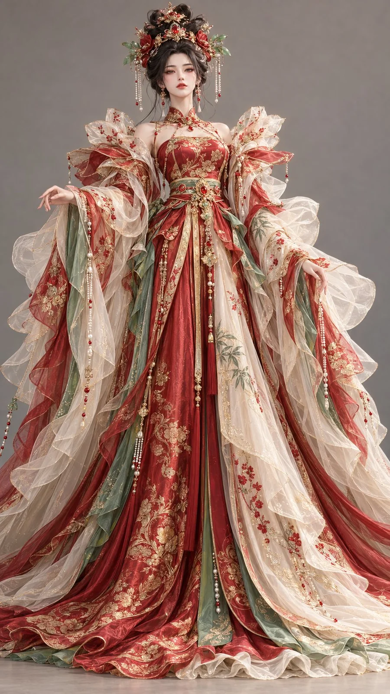

# Stylized 3D Eastern Fantasy Costume — Pomegranate Brocade

**中文标题：** 3D 东方幻想角色服装·石榴明锦  
**ID:** `gi25-x-1084` · **Mode:** `generate`  
**Categories:** `general`  
**Tags:** `x-twitter`, `community`, `gpt-image-2.5`, `x-direct`, `zh`



### Stylized 3D Eastern Fantasy Costume — Pomegranate Brocade

```text
9:16竖版，高精度风格化3D东方幻想女性角色原型，电影级CG角色美术，鲜艳华丽的中国色，服装材质精致梦幻，具有高级东方礼服气质。

一位25岁左右的成年东方幻想女性，容貌明艳华美，细长清亮的眼睛，柔和鹅蛋脸，鼻梁秀挺，唇色自然饱满，肌肤白皙细腻且富有生命感，神态端庄、高贵、略带威仪。身形纤细，姿态优雅稳定。

发型雕塑： 乌黑长发在头顶盘成饱满华丽的双层花冠髻，外围发束如盛开的花瓣般向外舒展，中央插有赤金花簪、细小石榴红宝石与竹青色玉叶饰件，耳侧垂下细长珠穗。

服饰设计： 身穿石榴红为主的大体量东方幻想礼服。主裙采用厚实柔亮的高档织金缎料，布面有精致妆花纹样与细密暗纹，在光线下呈现丰富层次。肩部与袖口展开巨大的花瓣式结构，外层以象牙白半透明雾纱覆盖，营造柔和梦幻的空气感。内层局部加入竹青色里衬和绣片，形成鲜艳色彩中的冷色平衡。裙摆宽阔厚重，但外部覆纱轻盈飘逸。胸前、腰封与裙缘大量使用赤金细线浮绣、立体珠绣与细小亮片，增强富贵与精工感。

色彩与材质控制： 石榴红为主色，竹青作为辅助点缀与局部层次，象牙白作为纱层缓冲与高光区，赤金用于绣纹、描边和头饰。整体重点突出重缎华丽光泽、雾纱梦幻覆盖、赤金刺绣与珠饰的精致奢华感。

高品质stylized 3D CG，真实发丝、柔亮重缎、半透明雾纱、妆花织金纹样、精细珠绣与金属细节，明亮影棚柔光，中性暖灰背景，正面全身构图。避免婚服感过重、整图大红俗艳、塑料感、普通宫装、文字水印。
```

- **Recommended model:** `gpt-image-2.5-sunburst`
- **Settings:** _(defaults)_
- **Source:** [community](https://x.com/liyue_ai/status/2114723492281385249) — @liyue_ai
- **License note:** Original public X post; quoted with attribution — remix with attribution
- **Notes:** Collected directly from X; original post https://x.com/liyue_ai/status/2114723492281385249; post text names GPT Image 2.5; discovered via Bin0754/gpt-image-gallery index, prompt re-verified against the original X post via api.fxtwitter.com; verified=True
- **Preview:** `previews/gi25-x-1084.webp`
