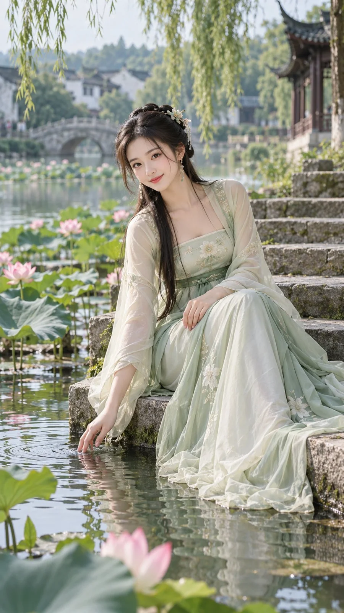

# Lotus Pond Jiangnan Gentle Hanfu Portrait

**中文标题：** 荷塘清梦·江南温婉古风人像  
**ID:** `gi25-x-1086` · **Mode:** `generate`  
**Categories:** `general`  
**Tags:** `x-twitter`, `community`, `gpt-image-2.5`, `x-direct`, `zh`



### Lotus Pond Jiangnan Gentle Hanfu Portrait

```text
9:16 竖版，8K 超写实唯美古风人像摄影，一位 23–27 岁成年东方女性，清秀灵动，柔和的小鹅蛋脸，平顺颧部，精致小巧的鼻梁，清澈明亮的杏眼，薄而自然红润的嘴唇，白皙细腻、弹润透光的真实皮肤，轻薄淡雅妆容。

深黑色长发采用半挽发髻造型，少量柔软碎发垂落脸颊，发间点缀淡绿色花簪与细小珍珠流苏。

穿着浅青绿色唐风改良汉服，内层为淡绿色真丝抹胸式上襦，外层搭配绣有细小花卉纹饰的薄纱大袖衫，长裙由乳白与浅青绿层叠丝绸组成，裙摆宽大柔软，铺展在石阶表面。

场景为江南古典园林的荷塘水岸，人物身后是石拱桥、亭台、垂柳、白墙黛瓦和大片粉色荷花，池水清澈，水面有细微涟漪。

人物侧坐在荷塘边的青灰色石阶上，身体微微前倾，一只手自然放在膝盖上，另一只手向下伸入水面，指尖轻触池水形成圆形涟漪，头部轻微倾斜，面向镜头露出温柔浅笑。

三分之二身到全身构图，略高于人物视线的侧前方机位，50mm 镜头，柔和自然散射光，前景荷花轻微虚化，背景园林景物层次分明。

真实户外拍摄效果，皮肤质感自然，布料垂坠真实，避免浮夸仙气特效、动漫感及不合理肢体姿态。
```

- **Recommended model:** `gpt-image-2.5-sunburst`
- **Settings:** _(defaults)_
- **Source:** [community](https://x.com/krienknight/status/2114533723068575863) — @krienknight
- **License note:** Original public X post; quoted with attribution — remix with attribution
- **Notes:** Collected directly from X; prompt posted as the author's reply https://x.com/krienknight/status/2114533723068575863 to https://x.com/krienknight/status/2114533722401685513, which carries the images and names GPT Image 2.5; discovered via Bin0754/gpt-image-gallery index, prompt re-verified against the original X post via api.fxtwitter.com; verified=True
- **Preview:** `previews/gi25-x-1086.webp`
