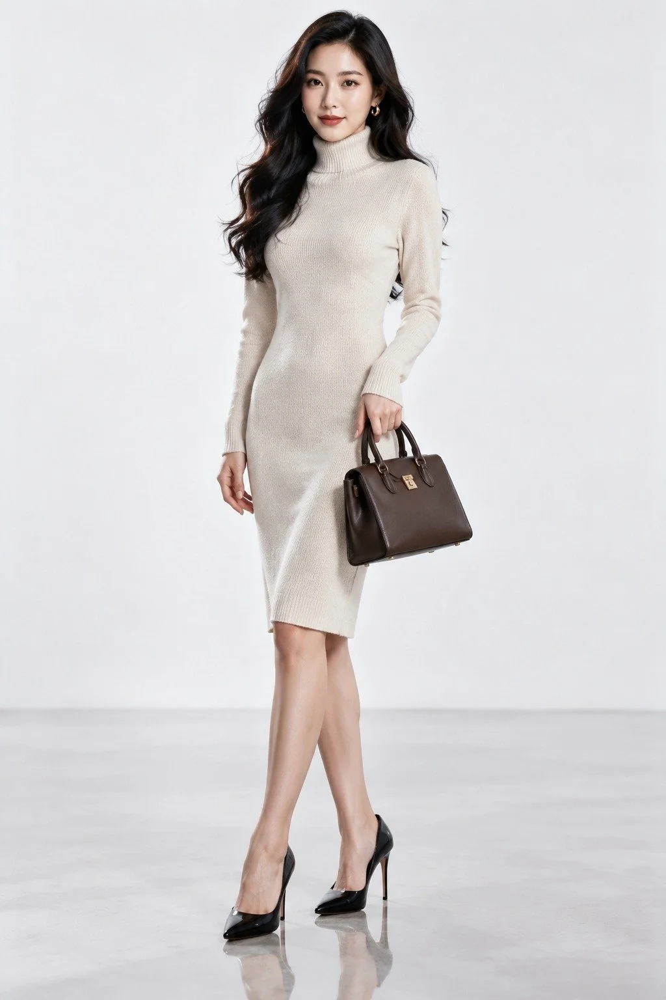

# Apple-Style Luxury Fashion Ad Portrait

**中文标题：** 苹果风奢华时尚广告人像  
**ID:** `gi25-x-1089` · **Mode:** `generate`  
**Categories:** `general`, `ecommerce`  
**Tags:** `x-twitter`, `community`, `gpt-image-2.5`, `x-direct`, `zh`



### Apple-Style Luxury Fashion Ad Portrait

```text
苹果风奢华时尚广告人像，clean minimal luxury advertising photography，Eastmancolor film look。一位28岁左右的成年女性，东方长相，五官精致立体，皮肤保留细腻毛孔和自然纹理，拒绝塑料磨皮，淡妆，唇色是哑光豆沙红，黑色大波浪长发垂至肩下，发丝带自然光泽。表情从容自信，目光直视镜头，嘴角带一丝淡淡笑意。服装是一件剪裁利落的米白色高领针织连衣裙，面料是细密羊绒混纺，贴合身形但不紧绷，裙摆及膝，搭配一双黑色尖头细跟高跟鞋和一只深棕色小牛皮手提包。姿态是站姿全身像，身体微微侧向镜头，一手自然垂落，另一手轻搭在手提包提手上，站姿挺拔优雅。道具只有手提包和一副简约金色耳环。环境是极简主义的纯白影棚，前景是光洁的浅灰色地面倒影，中景是人物站立的留白空间，远景是一面无缝纯白背景墙，画面干净无杂物。光线是柔和的棚拍主光，从画面左上方45度打下来，辅以右侧反光板补光，色温约5500K，明亮均匀，阴影过渡柔和，带轻微的轮廓光勾勒发丝。相机为85mm镜头，f/5.6，全身景别，eye-level机位，浅景深，人物清晰、背景纯净。调色偏冷白与暖肤色对撞，干净通透，film grain细腻。情绪是高级、克制、自信的奢华感。highly detailed, sharp focus, studio lighting, realistic texture。No oil painting, No anime, No 3D render, No deformed hands, No watermark, No text.
```

- **Recommended model:** `gpt-image-2.5-sunburst`
- **Settings:** _(defaults)_
- **Source:** [community](https://x.com/CandyTravelight/status/2114520750225035276) — @CandyTravelight
- **License note:** Original public X post; quoted with attribution — remix with attribution
- **Notes:** Collected directly from X; original post https://x.com/CandyTravelight/status/2114520750225035276; post text names GPT Image 2.5; discovered via Bin0754/gpt-image-gallery index, prompt re-verified against the original X post via api.fxtwitter.com; verified=True; comparison post; image 1 is GPT Image 2.5
- **Preview:** `previews/gi25-x-1089.webp`
