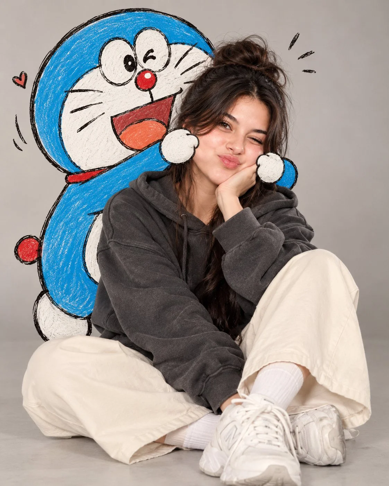

# Ultra-Realistic Girl with Doraemon Editorial Portrait

**中文标题：** 超写实女孩与哆啦A梦时尚人像  
**ID:** `gi25-x-1094` · **Mode:** `generate`  
**Categories:** `general`  
**Tags:** `x-twitter`, `community`, `gpt-image-2.5`, `x-direct`, `en`



### Ultra-Realistic Girl with Doraemon Editorial Portrait

```text
Ultra-Realistic Girl with Doraemon 💙✨

Create an ultra-realistic, cute editorial portrait of a stylish young woman sitting on a smooth light gray studio floor, playfully posing with a large, adorable Doraemon cartoon character behind her.

Subject: A beautiful young woman with dark brown hair tied in a messy high bun, soft wispy bangs, natural makeup, and a cute pouty expression. She is wearing an oversized charcoal gray hoodie, loose cream-colored pants, white crew socks, and chunky white sneakers. She sits casually with one knee raised and the other leg folded to the side, resting one cheek on her hand while looking directly at the camera with one eye slightly squinted.

Cartoon Character — Doraemon: Behind her is a large, adorable 2D hand-drawn Doraemon, the iconic blue robotic cat, featuring his round blue body, white face and belly, large expressive eyes, red nose, three whiskers on each cheek, red collar, and golden bell. Doraemon playfully leans toward the woman, extending his cartoon arms to gently squish both of her cheeks, creating a funny, cute expression. Doraemon has a slightly mischievous, affectionate expression, with a small black scribble floating above his head to suggest playful confusion.

Art Style: A seamless blend of photorealistic human photography and hand-drawn 2D cartoon illustration. The woman must look completely photorealistic, with realistic skin texture, natural facial details, and lifelike clothing. Doraemon must look like a cartoon sketched directly onto the photograph, with visible rough black marker outlines, subtle white pencil shading, imperfect sketch strokes, and charming hand-drawn details. Preserve Doraemon's recognizable blue-and-white appearance.

Lighting and Background: Minimalist light gray seamless studio background, soft diffused lighting, gentle natural shadows, neutral colors, and a cozy, whimsical atmosphere.

Composition: Full-body vertical portrait, 4:5 aspect ratio, centered composition, eye-level camera angle, natural seated pose, Doraemon positioned directly behind the woman, with his arms reaching around her face. Ensure both the woman and Doraemon are clearly visible and harmoniously integrated.

Quality: High-resolution photography, realistic skin texture, detailed fabric textures, soft cinematic lighting, clean composition, charming Korean social media aesthetic, cute and playful mood.

Important Instructions:

- Keep the woman fully photorealistic.
- Keep Doraemon visibly hand-drawn in 2D cartoon style.
- Preserve Doraemon's iconic blue body, white face, red nose, whiskers, collar, and bell.
- Make the cheek-squishing interaction look natural, funny, and adorable.
- Ensure anatomically correct human hands and clean cartoon anatomy.
- No extra fingers, distorted faces, text, logos, watermarks, or unnecessary background objects.
- Do not turn the entire image into an illustration or make Doraemon look like a realistic 3D character.
```

- **Recommended model:** `gpt-image-2.5-sunburst`
- **Settings:** _(defaults)_
- **Source:** [community](https://x.com/Rose5303508870/status/2114666301369270757) — @Rose5303508870
- **License note:** Original public X post; quoted with attribution — remix with attribution
- **Notes:** Collected directly from X; original post https://x.com/Rose5303508870/status/2114666301369270757; post text names GPT Image 2.5; discovered via Bin0754/gpt-image-gallery index, prompt re-verified against the original X post via api.fxtwitter.com; verified=True
- **Preview:** `previews/gi25-x-1094.webp`
