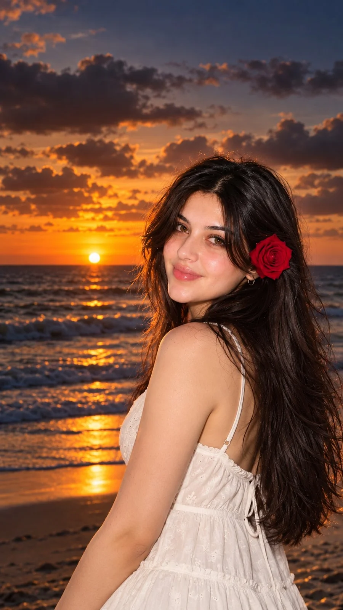

# Romantic Sunset Beach Cinematic Portrait

**中文标题：** 浪漫日落海边电影感人像  
**ID:** `gi25-x-1095` · **Mode:** `generate`  
**Categories:** `general`  
**Tags:** `x-twitter`, `community`, `gpt-image-2.5`, `x-direct`, `en`



### Romantic Sunset Beach Cinematic Portrait

```text
Romantic Sunset Beach Portrait 🌅🤍🌹

Create an ultra-realistic, cinematic portrait of a beautiful young woman standing by the ocean during a breathtaking golden sunset, looking back over her shoulder toward the camera.

Appearance: Long, thick, glossy dark brown-black hair cascading naturally down her back, softly tousled face-framing strands, warm glowing skin, subtle rosy cheeks, expressive brown eyes, natural eyeliner, glossy pink lips, and a gentle, confident smile. A beautiful deep-red rose is tucked behind one ear, complemented by small gold hoop earrings.

Outfit: An elegant white summer sundress with delicate eyelet embroidery, thin shoulder straps, a fitted bodice, a softly gathered waist, and a flowing, lightweight skirt. The fabric looks airy and natural, creating a romantic, feminine beach aesthetic.

Pose: Three-quarter side pose with her body turned away from the camera and her head gently turned back over her shoulder. Her long hair flows freely down her back, and she looks directly into the camera with a soft, charming expression.

Background: A spectacular ocean sunset with the bright golden sun resting just above the horizon, dramatic dark clouds illuminated by orange and amber light, gentle waves rolling toward the shore, and shimmering golden reflections stretching across the water. The upper sky transitions into muted dusky blue and purple tones.

Lighting: Warm golden-hour backlighting combined with a soft camera flash illuminating her face, hair, and white dress. Natural highlights on her skin, subtle shadows, glowing edges around her hair, and realistic reflections on the ocean.

Photography & Composition: Vertical 9:16 portrait, medium close-up to three-quarter body framing, subject positioned slightly right of center, sunset visible on the left, natural perspective, 85mm portrait lens, shallow depth of field, sharp facial focus, realistic skin texture, detailed hair strands, cinematic HDR, professional DSLR photography, rich warm color grading, 4K quality.

Mood & Style: Romantic, dreamy, elegant, feminine, peaceful, effortlessly beautiful, luxury beach editorial, photorealistic, cinematic Instagram aesthetic.

Negative prompt: Cartoon, anime, artificial skin, excessive smoothing, distorted facial features, extra fingers, deformed hands, unnatural body proportions, blurry face, oversaturated colors, fake-looking hair, text, logos, watermark.

Important: If using a reference photo, preserve the person's original facial identity and natural facial features while recreating the outfit, pose, lighting, and sunset background.
```

- **Recommended model:** `gpt-image-2.5-sunburst`
- **Settings:** _(defaults)_
- **Source:** [community](https://x.com/Rose5303508870/status/2114776272593465839) — @Rose5303508870
- **License note:** Original public X post; quoted with attribution — remix with attribution
- **Notes:** Collected directly from X; original post https://x.com/Rose5303508870/status/2114776272593465839; post text names GPT Image 2.5; discovered via Bin0754/gpt-image-gallery index, prompt re-verified against the original X post via api.fxtwitter.com; verified=True
- **Preview:** `previews/gi25-x-1095.webp`
