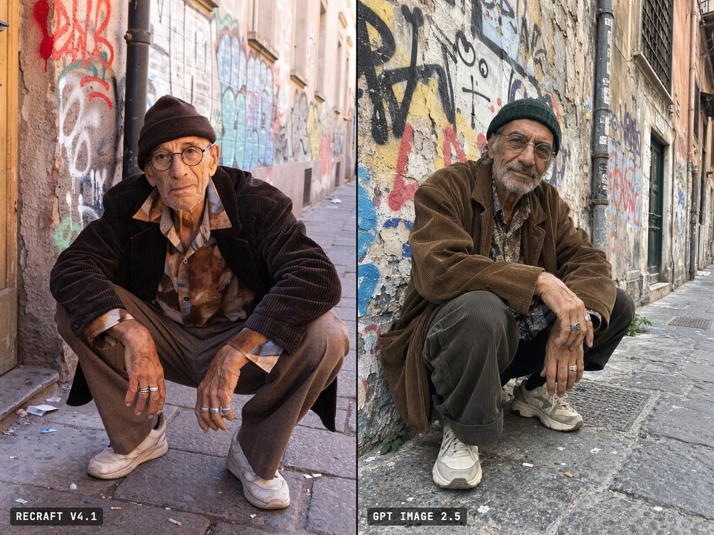

# Candid Elderly Hipster Phone-Snapshot Portrait

**中文标题：** 随手抓拍感的时髦老人手机人像  
**ID:** `gi25-x-1096` · **Mode:** `generate`  
**Categories:** `general`  
**Tags:** `x-twitter`, `community`, `gpt-image-2.5`, `x-direct`, `en`



### Candid Elderly Hipster Phone-Snapshot Portrait

```text
Candid smartphone photo of an elderly man in his late sixties with olive, sun-tanned wheat-colored skin, squatting down on the sidewalk of an authentic old side street, right in front of a weathered wall completely covered in layers of colorful graffiti and tags, looking straight into the camera and posing with quiet confidence. He is dressed in a very stylish hipster outfit: oversized vintage corduroy jacket, loose patterned shirt, wide-leg pleated trousers, plain unbranded chunky retro sneakers, a knit beanie, thin round glasses and a few silver rings. He is the only person in the frame; the quiet street around him is empty, with worn paving stones, a drainpipe, peeling paint and a little everyday litter. Plain natural daylight, true-to-life colors, real skin with deep wrinkles, age spots, uneven skin tone, visible pores and stray grey stubble. Handheld, slightly tilted framing, phone-camera sharpening and a little grain, an ordinary unedited amateur snapshot, as if a friend took it randomly on their phone. Vertical 2:3 frame.
```

- **Recommended model:** `gpt-image-2.5-sunburst`
- **Settings:** _(defaults)_
- **Source:** [community](https://x.com/mustansant/status/2114730703598362630) — @mustansant
- **License note:** Original public X post; quoted with attribution — remix with attribution
- **Notes:** Collected directly from X; prompt posted as the author's reply https://x.com/mustansant/status/2114730703598362630 to https://x.com/mustansant/status/2114730540092047436, which carries the images and names GPT Image 2.5; discovered via Bin0754/gpt-image-gallery index, prompt re-verified against the original X post via api.fxtwitter.com; verified=True; author posted it as a same-prompt Recraft v4.1 vs GPT Image 2.5 comparison
- **Preview:** `previews/gi25-x-1096.webp`
