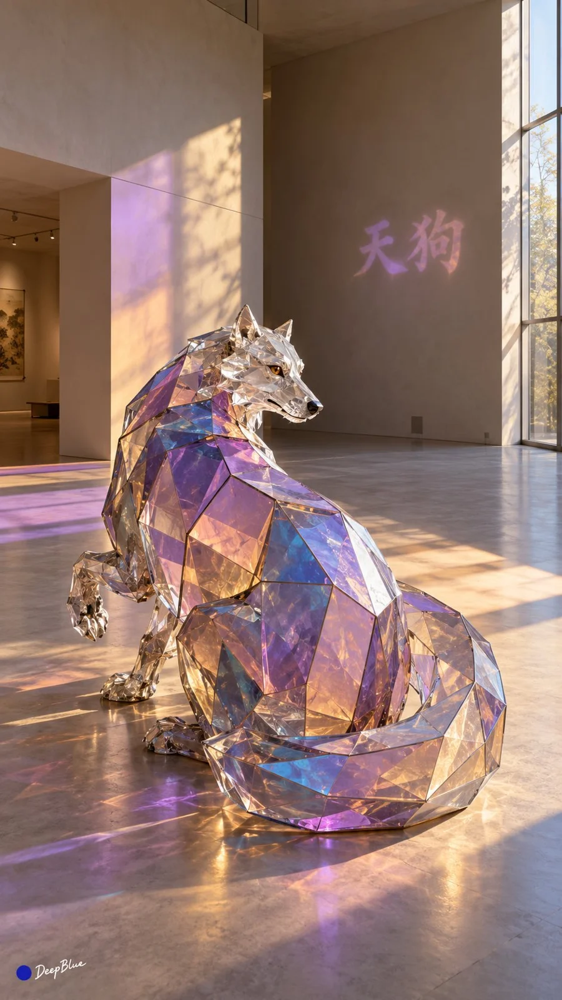

# Shan Hai Jing Beasts as Low-Poly Dichroic Glass Installations

**中文标题：** 山海经异兽·低多边形二向色玻璃装置  
**ID:** `gi25-x-1097` · **Mode:** `generate`  
**Categories:** `general`  
**Tags:** `x-twitter`, `community`, `gpt-image-2.5`, `x-direct`, `zh`



### Shan Hai Jing Beasts as Low-Poly Dichroic Glass Installations

```text
山海经奇珍异兽 × 低多边形造型 × 二向色玻璃艺术 × 彩色透射与反射 × 空间光影 × 名称文字投影

每张独立选择一种《山海经》中轮廓鲜明、适合玻璃表达的奇珍异兽，转化为简洁的空间艺术装置。依据原文保留体形与身份特征，确保关键结构及数量准确。10张异兽与主结构各异，每张重新变化姿态、玻璃构成、机位、构图、建筑空间与日光方向。

以少量宽阔、大小有层次的多边形玻璃面建立连贯体积，仅在轮廓与主要结构转折处增加分面。以四边形及不规则多边形为主，局部三角面辅助转折，大面积平缓部位保持完整，内部空间简洁。

躯干保持完整体块，肢体以简练折面表现关节与受力。角、翼、尾等依据自身形态采用宽阔薄面或简练多面体，与身体自然连接。优先保证辨识结构数量准确，再安排姿态与视角，使连接位置和末端便于辨认，轮廓间保留疏朗空隙。

动作具有生物逻辑，身体朝向、重心与附属结构相互呼应，保留古拙、神秘的生命感，表面细节高度概括。

相邻玻璃面沿共同边缘简洁衔接，以不同倾角建立体积。表面平整，薄板厚度与硬质边缘清楚，接缝克制，支撑或悬吊顺应重心，制作与安装可信。

玻璃清透，背景可透过主要玻璃面辨认，前后表面的叠合保持清楚。依据异兽气质组织色彩，显色随朝向及透射、反射关系变化。相邻折面色彩有别，面内相对完整，边缘与少量交叠处细腻变化，保留无色透明区域。

明确日光形成一组主要色光关系，彩色透射光与反射光落在地面或墙面，色块宽阔疏朗，位置与形状符合玻璃朝向和光路，辅助反光轻淡。

隐蔽的小型投影灯通过文字字模与二向色滤色片，将异兽准确中文名投在墙面或地面的留白处，仅出现一次。采用清楚端正的楷书，尺寸随字数与空间调整，完整画面中可读，视觉分量低于主体。优先选择侧后方较暗墙面；地面选择透视倾斜较小的位置。

名称沿用主要色光中的一种颜色，局部轻淡色差，亮度克制、字形清晰、边缘微柔。承接表面纹理自然可见，文字遵循平面透视，与主要彩色光块适当错开。

简洁的中性色建筑环境，空间尺度、背景明度与光线随造型变化。主体完整入镜，四周留出舒适边距，兼顾异兽辨识、立体结构、空间光影与名称阅读。真实艺术装置摄影，自然曝光，玻璃与色光层次清楚，主体保持视觉重心。

n=10，连续生成10张独立单图，每次1张，9:16竖幅。
左下签名：深蓝色实心圆点在前，白色手写体「DeepBlue」在后。
```

- **Recommended model:** `gpt-image-2.5-sunburst`
- **Settings:** _(defaults)_
- **Source:** [community](https://x.com/DeepBlueX0/status/2114687464459862119) — @DeepBlueX0
- **License note:** Original public X post; quoted with attribution — remix with attribution
- **Notes:** Collected directly from X; original post https://x.com/DeepBlueX0/status/2114687464459862119; post text names GPT Image 2.5; discovered via Bin0754/gpt-image-gallery index, prompt re-verified against the original X post via api.fxtwitter.com; verified=True
- **Preview:** `previews/gi25-x-1097.webp`
