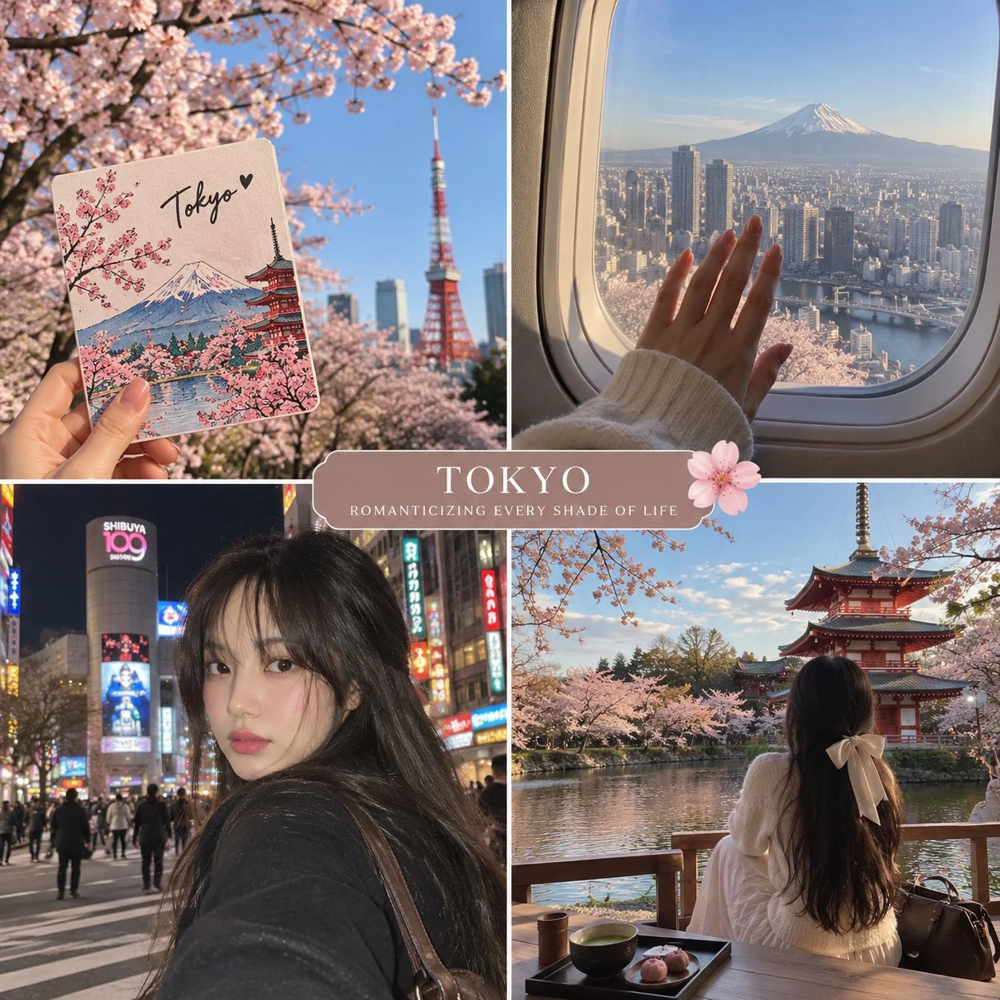

# 2×2 Photorealistic Travel Diary Template

**中文标题：** 2×2 写实旅行日记模板  
**ID:** `gi25-x-1102` · **Mode:** `generate`  
**Categories:** `general`  
**Tags:** `x-twitter`, `community`, `gpt-image-2.5`, `x-direct`, `en`



### 2×2 Photorealistic Travel Diary Template

```text
Create a beautiful, photorealistic 2×2 travel diary collage inspired by the feeling of romanticizing life while exploring [COUNTRY / STATE / CITY]. Capture the destination through four aesthetic snapshots that feel like personal travel memories collected in a scrapbook.

Top Left — A Little Reminder to Slow Down
A hand reaches toward a dreamy blue sky, holding a handwritten or elegant script word such as “Breathe,” “Wander,” “Dream,” or a phrase inspired by the destination. Below, capture a subtle glimpse of the local skyline, mountains, historic buildings, or landscape.

Top Right — Somewhere Between Here and There
A candid view through an airplane, train, or car window, revealing the beautiful landscapes of [DESTINATION]. A hand rests near the window, sunlight spills across the frame, and the view feels full of possibility and anticipation.

Bottom Left — A Memory Made by Hand
A hand holds an open travel journal or illustrated postcard featuring a charming, minimalist doodle inspired by [DESTINATION] — its iconic landmark, local flowers, traditional architecture, mountains, lakes, or cultural symbols. Include delicate handwritten words such as “[DESTINATION] SOUL” or “A little piece of [DESTINATION].” Place the scene against a recognizable local landscape.

Bottom Right — A Moment I Wish Could Last Forever
A candid photograph of a young woman seen from behind, sitting beside a beautiful view unique to [DESTINATION]. She might be overlooking a lake, sitting by the sea, watching mountain peaks, exploring a historic street, or enjoying a peaceful cityscape. Her hair moves gently in the breeze as she takes in the scenery.

Visual style: Soft natural daylight, dreamy blue skies, delicate white clouds, sun-washed colors, realistic travel photography, subtle film grain, candid framing, and a calm, nostalgic atmosphere.

Design: Four equally sized photographs arranged in a clean 2×2 grid. Add a slim navy-blue rounded caption strip across the center with the phrase “Romanticizing Every Shade of Life.” Include one tiny white or pale-blue flower illustration as a decorative scrapbook detail.

Color palette: Sky blue, ocean teal, soft white, muted navy, and warm natural neutrals.

Mood: Slow living, solo adventures, quiet happiness, wanderlust, personal memories, and finding beauty in ordinary moments.

Important: Adapt every scene to the real geography, recognizable landmarks, local scenery, and cultural details of [DESTINATION]. Keep the collage cohesive, elegant, photorealistic, and emotionally evocative. No generic mismatched scenery, distorted hands, excessive filters or landmarks
```

- **Recommended model:** `gpt-image-2.5-sunburst`
- **Settings:** _(defaults)_
- **Source:** [community](https://x.com/Naiknelofar788/status/2114938742721204385) — @Naiknelofar788
- **License note:** Original public X post; quoted with attribution — remix with attribution
- **Notes:** Collected directly from X; original post https://x.com/Naiknelofar788/status/2114938742721204385; post text names GPT Image 2.5; discovered via X search, prompt re-verified against the original X post via api.fxtwitter.com; verified=True
- **Preview:** `previews/gi25-x-1102.webp`
