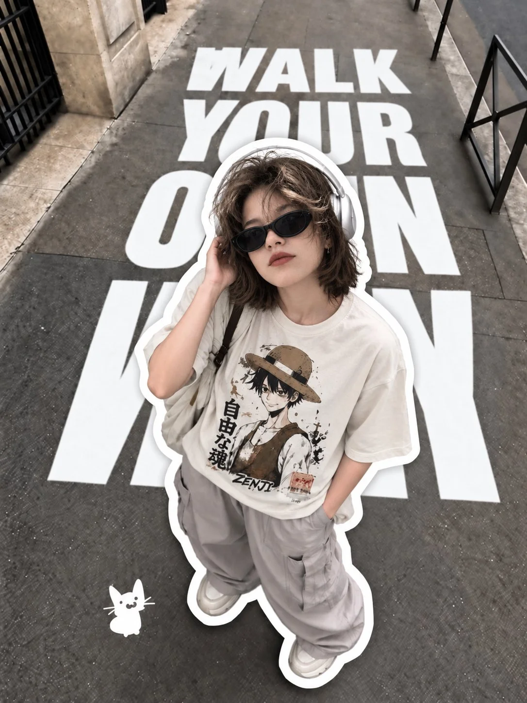

# Gen Z Fisheye Streetwear Editorial

**中文标题：** Z 世代鱼眼街头潮流大片  
**ID:** `gi25-x-1103` · **Mode:** `generate`  
**Categories:** `general`  
**Tags:** `x-twitter`, `community`, `gpt-image-2.5`, `x-direct`, `en`



### Gen Z Fisheye Streetwear Editorial

```text
Create a photorealistic Gen Z streetwear editorial photograph, vertical 4:5 aspect ratio, shot from an extreme overhead angle with a 14mm fisheye lens.

Subject: A stylish young woman standing on a gray urban sidewalk, looking directly up at the camera. She has a tousled, wavy ash-brown bob haircut, natural makeup, black narrow cat-eye sunglasses, and a calm, confident expression. She wears oversized white over-ear headphones, an oversized cream anime graphic T-shirt, loose gray cargo pants, and chunky off-white sneakers. A black crossbody bag strap runs across her shoulder. One hand touches her headphones while the other rests casually in her pocket.

Composition: Capture her entire body from directly above, with strong fisheye distortion making her head and upper body appear slightly larger. Add a thick, irregular white sticker-cutout outline around her entire silhouette, cleanly separating her from the pavement.

Typography: Place enormous bold, condensed sans-serif white lettering directly across the sidewalk, reading “WALK YOUR OWN WAY.” Stack the words vertically, with letters partially cropped by the frame and naturally hidden behind the subject. The typography should feel like a premium streetwear magazine cover, not road markings or handwritten text.

Background: Realistic gray concrete pavement with subtle cracks and texture, black metal railings along the sidewalk, and a small white hand-drawn cat doodle near the lower-left corner.

Style: Modern Pinterest aesthetic, Gen Z fashion collage, realistic street photography, muted neutral colors, soft natural daylight, subtle film grain, crisp clothing textures, realistic shadows, and professional editorial composition.

Important: Preserve realistic anatomy, natural proportions, accurate clothing details, and legible typography. No extra people, logos, watermarks, neon colors, cartoon rendering, or 3D text.
```

- **Recommended model:** `gpt-image-2.5-sunburst`
- **Settings:** _(defaults)_
- **Source:** [community](https://x.com/Ziha_ai/status/2114936362239427060) — @Ziha_ai
- **License note:** Original public X post; quoted with attribution — remix with attribution
- **Notes:** Collected directly from X; original post https://x.com/Ziha_ai/status/2114936362239427060; post text names GPT Image 2.5; discovered via X search, prompt re-verified against the original X post via api.fxtwitter.com; verified=True
- **Preview:** `previews/gi25-x-1103.webp`
