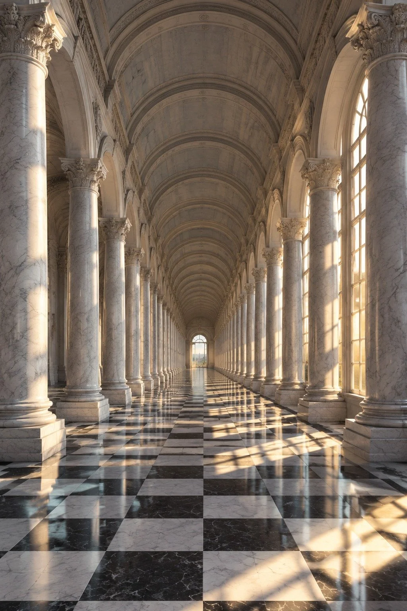

# One-Point Perspective Marble Palace Colonnade Test

**中文标题：** 单点透视大理石宫殿长廊测试  
**ID:** `gi25-x-1105` · **Mode:** `generate`  
**Categories:** `general`  
**Tags:** `x-twitter`, `community`, `gpt-image-2.5`, `x-direct`, `zh`



### One-Point Perspective Marble Palace Colonnade Test

```text
一座古典欧式宫殿的超长对称柱廊长廊，正面透视测试场景。地点是室内大理石长廊，时间是午后，阳光从右侧一排高大的拱形窗户斜射进来。长廊两侧各有一排完全相同的白色大理石圆柱和半圆拱门，沿着一条笔直的中轴线向远方均匀延伸、逐级缩小，直至汇聚到画面尽头的一个圆形拱门亮点；地面是黑白相间的大理石棋盘格，每块方砖的边线都沿透视方向收敛，越远越密。拱顶是连续的筒形穹顶，肋线同样向远方收束。光线为窗户透进来的暖金色侧光，色温约3500K，在棋盘格地面上投出与窗拱形状一致的长方形光斑，光斑也随透视缩小。背景分层：前景是最近的一对圆柱和一块棋盘格地面，中景是重复的柱列与窗光，远景是尽头的圆形拱门和门外的一小片亮光。相机位于长廊正中央、与地面齐平的水平视线高度，35mm焦段，单点透视正面构图，景深从近到远都清晰，f/8小光圈。调色为暖金与冷灰大理石的对撞，带轻微film grain颗粒感。构图严格对称，消失点落在画面正中心。整体情绪是庄严、秩序、纵深感极强。超精细建筑细节，8K画质，photorealistic，architectural photography。No oil painting, No anime, No 3D render, No warped columns, No distorted arches, No bent perspective lines, No text, No watermark.
```

- **Recommended model:** `gpt-image-2.5-sunburst`
- **Settings:** _(defaults)_
- **Source:** [community](https://x.com/JimmyCarsttle/status/2114920830992109909) — @JimmyCarsttle
- **License note:** Original public X post; quoted with attribution — remix with attribution
- **Notes:** Collected directly from X; original post https://x.com/JimmyCarsttle/status/2114920830992109909; post text names GPT Image 2.5; discovered via X search, prompt re-verified against the original X post via api.fxtwitter.com; verified=True; comparison post; image 1 is GPT Image 2.5
- **Preview:** `previews/gi25-x-1105.webp`
