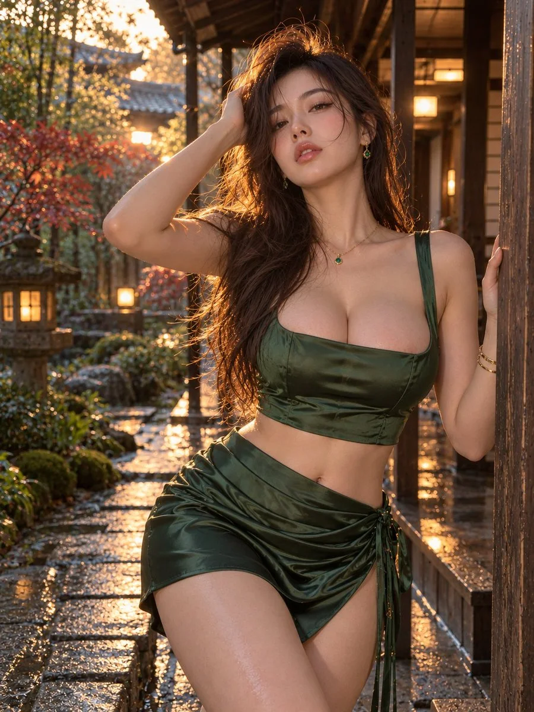

# Courtyard Satin Editorial Fashion Portrait

**中文标题：** 庭院缎面时尚大片人像  
**ID:** `gi25-x-1112` · **Mode:** `generate`  
**Categories:** `general`  
**Tags:** `x-twitter`, `community`, `gpt-image-2.5`, `x-direct`, `en`



### Courtyard Satin Editorial Fashion Portrait

```text
Photorealistic editorial fashion portrait, vertical 3:4, framed from head to mid-thigh. A 25-year-old woman with long windswept brunette hair leans beside a dark wooden veranda post, one hand lifting her hair, the other resting on the post. Forest-green satin square-neck crop top and matching draped wrap miniskirt tied at the hip, emerald earrings and pendant, slender gold bracelets. Direct gaze, softly parted lips, natural dewy skin. Traditional Japanese courtyard with mossy stones, red maple foliage, glowing stone lanterns and rain-wet paving. Golden sunset backlight, soft facial fill, rich satin reflections, shallow depth of field, fine film grain. No text or watermark.
```

- **Recommended model:** `gpt-image-2.5-sunburst`
- **Settings:** _(defaults)_
- **Source:** [community](https://x.com/HuguClubs/status/2114784122883174797) — @HuguClubs
- **License note:** Original public X post; quoted with attribution — remix with attribution
- **Notes:** Collected directly from X; original post https://x.com/HuguClubs/status/2114784122883174797; post text names GPT Image 2.5; discovered via X search, prompt re-verified against the original X post via api.fxtwitter.com; verified=True
- **Preview:** `previews/gi25-x-1112.webp`
