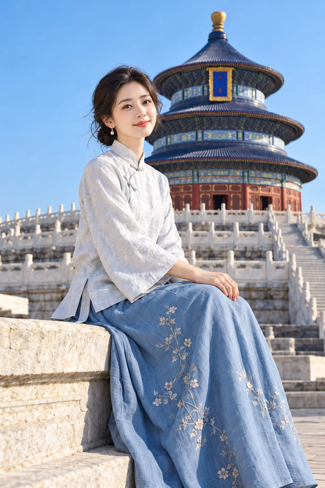

# Temple of Heaven New-Chinese Travel Portrait

**中文标题：** 天坛新中式旅行素雅人像  
**ID:** `gi25-x-1117` · **Mode:** `generate`  
**Categories:** `general`  
**Tags:** `x-twitter`, `community`, `gpt-image-2.5`, `x-direct`, `zh`



### Temple of Heaven New-Chinese Travel Portrait

```text
2:3竖版，新中式旅行人像摄影，真实成年东方女性，北京天坛祈年殿实景，晴朗蓝天，清透自然的日光，人物与建筑均具有真实摄影质感。

【人物】
一位25岁左右的东方女性，清秀亲切的邻家气质，柔和的小鹅蛋脸，面颊饱满适度，下颌线自然流畅，小巧下巴，清澈杏眼，自然细眉，小巧挺秀的鼻梁。嘴形小而不宽，薄而柔润的浅玫瑰色嘴唇，闭唇浅笑，目光温柔地看向镜头。皮肤白皙细腻，保留自然血色、细微肌理与柔和光泽，妆容清淡。

【发型与配饰】
深棕黑色头发自然侧分，松挽低位发髻，额前和鬓角有少量随风飘动的细发，佩戴小巧的金色珍珠垂坠耳饰，整体干净简雅。

【服装】
身穿月白偏浅冰蓝色的新中式提花上衣，小立领、斜襟盘扣、七分微宽袖，衣身略收腰，侧边开衩，衣摆自然覆盖腰胯。细密的真丝提花面料，织有低对比度的白色花叶暗纹，柔和日光下呈现细腻而克制的光泽。

下搭雾霾蓝高腰长裙，裙摆宽松垂坠，从膝部自然铺展至画面下缘。裙面点缀疏朗的米白、浅粉色花枝刺绣，细枝沿裙身纵向延伸，图案精致，保留大面积蓝色留白。面料柔韧、有重量感，形成宽而自然的衣褶，不使用粗糙棉麻或廉价亮缎。

【姿势】
人物侧坐在浅色石台边缘，身体与双膝朝向画面右侧，上身自然挺直，肩膀放松，脸转回镜头，头部基本端正，下巴轻轻抬起。双臂自然向前，一只手轻放在膝上，另一只手松弛地叠放于附近，手指舒展。双腿由长裙完整覆盖，裙摆沿石阶向右下方垂落，坐姿舒适端庄。

【场景与构图】
人物位于画面左侧至中央，采用从头顶至长裙下摆的大半身坐姿构图，裙摆延伸出画面底部，不强行露出鞋脚。北京天坛祈年殿位于人物右后方，占据背景上半部，三重蓝色琉璃瓦圆形屋顶、金色宝顶、彩绘梁枋与朱红殿身清晰可辨，建筑比例自然。

中景为层叠的汉白玉栏杆与石阶，前景左下方为有岁月纹理的浅米白色石台。人物头部与建筑主体适当错开，保留屋顶轮廓和顶部蓝天，画面有清楚的前、中、后景层次。

【光线与摄影】
晴日上午的自然侧光，来自画面左前方，柔和照亮脸部、衣袖与裙褶，地面反射光补亮阴影。蓝天干净，白色石栏不过曝，面部明暗自然，发丝边缘略带暖光。

中长焦人像摄影质感，接近人物胸口高度的平视机位，人物面部与服饰清晰，背景适度柔化但仍保留祈年殿的建筑结构。整体配色为月白、雾霾蓝、天空蓝与米白，少量朱红和金色点缀。高清细节，自然色彩，无文字、无水印、无拼图。

避免：动漫脸、塑料皮肤、厚唇宽唇、夸张大眼、尖下巴、过度磨皮锐化、短腿比例、耸肩、手指畸形、衣料塑料反光、密集繁杂花纹、建筑变形、屋顶裁切、背景人群。
```

- **Recommended model:** `gpt-image-2.5-sunburst`
- **Settings:** _(defaults)_
- **Source:** [community](https://x.com/krienknight/status/2114567701058232361) — @krienknight
- **License note:** Original public X post; quoted with attribution — remix with attribution
- **Notes:** Collected directly from X; original post https://x.com/krienknight/status/2114567701058232361; post text names GPT Image 2.5; discovered via X search, prompt re-verified against the original X post via api.fxtwitter.com; verified=True
- **Preview:** `previews/gi25-x-1117.webp`
