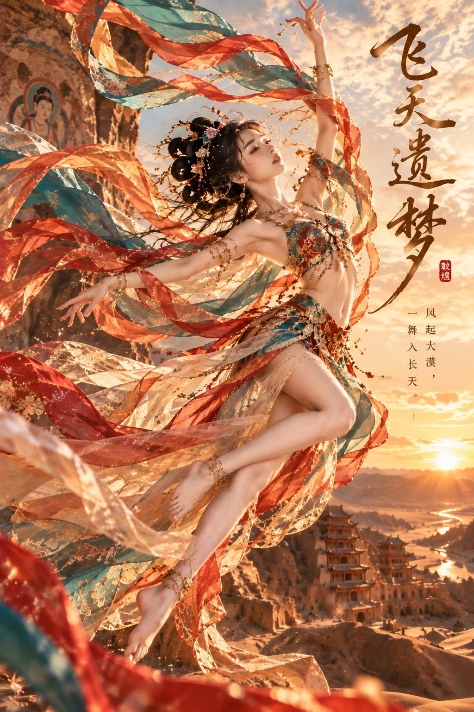

# Dunhuang Flying Apsara Cinematic Fantasy Portrait

**中文标题：** 《飞天遗梦》敦煌飞天电影级东方幻想人像  
**ID:** `gi25-x-1118` · **Mode:** `generate`  
**Categories:** `general`, `poster-typography`  
**Tags:** `x-twitter`, `community`, `gpt-image-2.5`, `x-direct`, `zh`



### Dunhuang Flying Apsara Cinematic Fantasy Portrait

```text
《飞天遗梦》｜敦煌飞天 · 电影级东方幻想人像

【画面规格与风格】

9:16 竖版，8K 超高清，东方敦煌飞天美学，电影级奇幻写实人物摄影，真实成年东方女性，真人皮肤、真实五官、真实丝绸材质与摄影光影，融合敦煌壁画艺术、盛唐服饰元素及现代高级定制时装设计。

画面华丽、明亮、富有动态张力，赤金色夕阳与孔雀青、朱砂红丝绸形成鲜明对比，具有电影海报级视觉冲击力。

【人物面容与身材】

一位 25 岁左右的成年东亚女性，青春靓丽，清秀精致的小鹅蛋脸，颧骨平顺，下颌自然收窄，下巴柔和圆润。

清澈明亮的杏眼，大小真实自然，小巧精致的鼻梁，薄而柔润的淡红色嘴唇，带自然唇纹。皮肤冷白细腻、弹润透光，保留真实毛孔、细微肌理与自然血色。

身材高挑纤细，腰线优美，四肢修长匀称，双腿线条流畅，头身比例协调，整体姿态优雅轻盈。

黑色长发挽成复杂而轻盈的敦煌飞天高髻，点缀精致金色花枝、珠串、宝石发饰及细小流苏，部分长发随风飘散。

【服装设计】

敦煌飞天风格的现代高级定制舞蹈服，融合盛唐壁画纹样。

上身为孔雀青色与赤金色刺绣短款舞衣，采用精致的金线莲花纹、宝石镶嵌与细密珠饰，肩部与手臂自然舒展，腰腹线条清晰。

下身为孔雀青、朱砂红、琥珀金与乳白色组合的层叠真丝舞裙，裙摆采用不对称流线剪裁，随飞舞动作自然舒展，展现真实轻盈的丝绸动态。

腰间饰有金色花纹腰链、细小流苏与宝石配饰，手腕及脚踝佩戴精致金色舞蹈饰品。

多条超长半透明飞天飘带从肩部、手臂及腰际向外延伸，采用朱砂红、孔雀青和透明金纱材质，表面带有精细金色云纹。

飘带在空中形成多个宽阔流畅的 S 形曲线，围绕人物身体盘旋，具有真实风力方向、丝绸重量感与透光效果。

【人物动作与姿态】

人物正在敦煌石窟外的高空中翩然飞舞，身体呈优美的斜向上腾空姿态。

上半身微微向后舒展，头部自然仰起，脸部转向画面右上方，眼神望向远处天空，神态宁静、自信、带有一丝神秘感。

右臂向头顶上方优雅伸展，手指自然张开，左臂向身体左侧舒展，与飘带形成流畅的动态曲线。

一条腿自然向后下方伸展，另一条腿在膝部轻微弯曲，双脚离开地面，脚尖自然延伸，形成真实优美的空中舞蹈姿态。

整个人物具有明确的腾空高度和运动方向，不是站立摆拍，不是坐姿，不是悬挂在地面附近。

【背景场景】

中国敦煌大漠，金色夕阳时分。

画面左侧是巨大的敦煌石窟岩壁，岩壁表面具有真实风化砂岩纹理，局部可见古老飞天壁画、佛教艺术装饰与石窟入口。

人物身后是辽阔的金色沙漠、层叠起伏的砂岩山脉、古代丝绸之路建筑遗迹与远方蜿蜒的河流。

远景中，夕阳正接近地平线，金色光芒穿透薄云，将整片沙漠染成温暖的琥珀色。

空气中漂浮少量细小金色沙尘，增强空间层次，但不遮挡人物面部。

【构图与镜头】

9:16 竖版电影海报构图，人物占画面高度约 70%，整体位于画面左侧及中央区域。

略低机位向上拍摄，35mm 电影摄影镜头，强调人物真实腾空感与大漠空间纵深。

人物面部清晰精致，服装刺绣、飘带和肢体细节清晰，背景石窟与远方建筑具有自然景深。

人物右侧天空保留适量干净留白，用于安排竖排书法标题。

夕阳从人物右后方照射，形成金色轮廓光，照亮发丝、肩颈、手臂和半透明飘带。脸部有柔和补光，避免逆光导致五官过暗或高光过曝。

【中文文字设计】

画面右上方竖排主标题：

飞天遗梦

使用舒展有力、笔锋清晰的中国传统毛笔书法，深暖褐色墨迹，字形自然，大小有节制，竖向排列，不遮挡人物。

标题下方偏右位置，使用细致端正的宋体竖排小诗：

风起大漠，

一舞入长天。

字色采用深暖褐色，字距适当放松，整体轻盈雅致。

标题旁点缀一枚小型朱砂红色篆刻印章，内容为“敦煌”，尺寸小巧。

文字与人物形成平衡，不使用巨大标题，不堆砌文字，不出现英文和无关标识。

【真实质感与负面约束】

超写实真人摄影，真实皮肤、真实发丝、真实人体结构、真实刺绣与丝绸纹理。

避免动漫脸、二次元、CG 游戏人物、塑料皮肤、过度磨皮、过度锐化、夸张大眼、宽厚嘴唇、网红模板脸、脸部过曝、身体比例畸形、手指错误、肢体扭曲、脚踝异常、飘带杂乱、服装材质廉价、背景模糊成色块、人物贴图感、过多粒子特效、错误中文、乱码文字。

最终效果：一张兼具东方女性真实美感、敦煌飞天艺术、华丽丝绸动态、宏大沙漠场景与诗意书法的高端电影海报。
```

- **Recommended model:** `gpt-image-2.5-sunburst`
- **Settings:** _(defaults)_
- **Source:** [community](https://x.com/krienknight/status/2114545048805396487) — @krienknight
- **License note:** Original public X post; quoted with attribution — remix with attribution
- **Notes:** Collected directly from X; original post https://x.com/krienknight/status/2114545048805396487; post text names GPT Image 2.5; discovered via X search, prompt re-verified against the original X post via api.fxtwitter.com; verified=True
- **Preview:** `previews/gi25-x-1118.webp`
