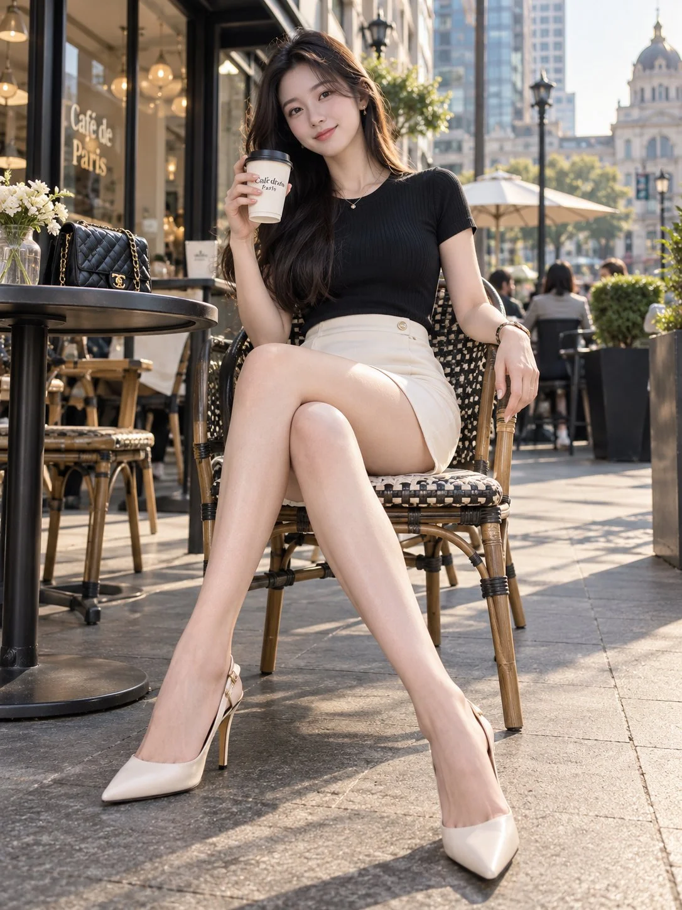

# Urban Chic Street Lookbook Portrait

**中文标题：** 都市丽人街头 Lookbook 人像  
**ID:** `gi25-x-1119` · **Mode:** `generate`  
**Categories:** `general`  
**Tags:** `x-twitter`, `community`, `gpt-image-2.5`, `x-direct`, `zh`



### Urban Chic Street Lookbook Portrait

```text
3:4 竖版，8K 超写实都市时尚 Lookbook 摄影，一位 24–28 岁成年东方女性，清秀精致的小鹅蛋脸，柔和自然的五官，清澈眼神，薄而红润的嘴唇，冷白透亮且保留细微真实肌理的皮肤。长发自然蓬松，发尾微卷。

人物身材纤细高挑，腰部线条流畅，双腿修长笔直，比例协调，膝盖与脚踝结构真实自然。

穿着黑色高级细罗纹修身短袖针织上衣、奶油白色高腰修身短裙、浅米白色尖头细高跟鞋，佩戴精致细项链、耳钉及腕表。

场景为欧洲风格的城市露天咖啡厅，人物坐在黑白编织藤椅上，身体略微后靠，双腿自然交叉，一条腿斜向镜头前方延伸，形成真实自然的近大远小透视，脚尖与鞋跟完整入镜。

右手轻拿外带咖啡杯靠近肩部，另一只手自然搭在椅子扶手上，轻轻歪头看向镜头，微笑自信。

左侧摆放黑色圆形咖啡桌、白色鲜花和精致皮质手袋，背景为城市建筑、街灯、露天遮阳伞与虚化行人。

全身构图，低于人物胸口高度的机位，35mm 镜头，自然下午侧光，人物面部和双腿清晰，背景具有真实街头空间感。保持腿部解剖准确，避免关节扭曲、脚掌放大及过度拉伸。
```

- **Recommended model:** `gpt-image-2.5-sunburst`
- **Settings:** _(defaults)_
- **Source:** [community](https://x.com/krienknight/status/2114514848965148977) — @krienknight
- **License note:** Original public X post; quoted with attribution — remix with attribution
- **Notes:** Collected directly from X; original post https://x.com/krienknight/status/2114514848965148977; post text names GPT Image 2.5; discovered via X search, prompt re-verified against the original X post via api.fxtwitter.com; verified=True
- **Preview:** `previews/gi25-x-1119.webp`
