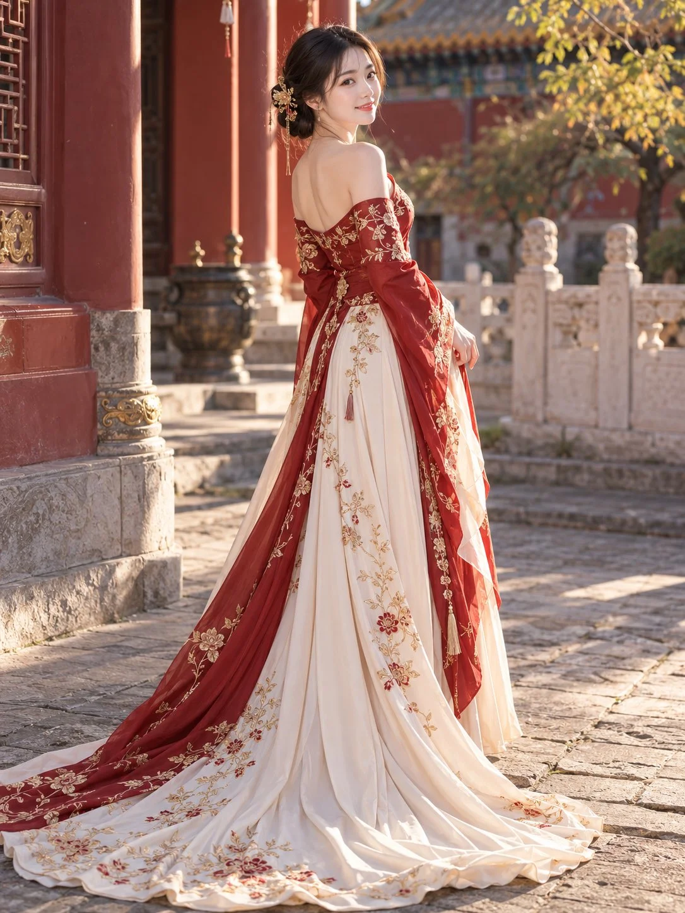

# New-Chinese Court Couture Gown Portrait

**中文标题：** 新中式宫廷高定礼服人像  
**ID:** `gi25-x-1122` · **Mode:** `generate`  
**Categories:** `general`  
**Tags:** `x-twitter`, `community`, `gpt-image-2.5`, `x-direct`, `zh`



### New-Chinese Court Couture Gown Portrait

```text
3:4竖版，全身新中式高定礼服人像摄影。一位25岁的成年东方女性，清秀柔和的小鹅蛋脸，清澈杏眼、小巧鼻梁、薄而自然的淡红嘴唇，白皙透亮的皮肤保留细微肌理与自然血色。黑色长发松挽低髻，额前几缕轻柔碎发，佩戴精致金色花枝发簪与垂坠流苏。

身穿朱红与象牙白配色的新中式刺绣拖尾礼服，露肩设计，后背领口呈柔和低弧线，露出肩颈与上背。朱红色修身上身搭配垂落的宽大长袖，衣身与袖口布满细腻金线花枝刺绣，腰部收束，腰侧垂挂细长流苏。象牙白长裙带有金色藤蔓与少量朱红花朵刺绣，朱红外层裙片从腰后延伸，与白色裙摆交叠，形成宽阔舒展的长拖尾，自然铺展在石板地面上。丝绸、缎面与轻薄纱层具有真实垂坠感，褶皱柔软流畅，刺绣精细。

人物背部朝向镜头，身体呈四分之三背面站姿，头部向右后方转回看镜头，露出清晰侧正面，轻轻微笑。双臂自然垂落并略微弯曲，手指轻拢身侧裙料，姿态舒展优雅。

背景为中式宫廷庭院，左侧朱红廊柱与雕花木门，远处灰瓦彩绘屋檐、青铜香炉、汉白玉雕花栏杆，右上方点缀金黄色秋叶。午后暖阳从画面右后方斜射，勾勒发丝、肩背与裙摆边缘，石板路上投下柔和长影。红、金、象牙白配色协调，背景适度虚化，人物面部与礼服刺绣清晰。自然人像摄影，真实皮肤，细腻高光，不过曝，不过度磨皮，无文字、无水印。

反向提示词：

动漫脸、塑料皮肤、尖下巴、夸张大眼、厚宽嘴唇、过度磨皮、过曝、过度锐化、廉价布料、僵硬裙摆、刺绣模糊、手指畸形、身体扭曲、拖尾裁切、杂乱背景。
```

- **Recommended model:** `gpt-image-2.5-sunburst`
- **Settings:** _(defaults)_
- **Source:** [community](https://x.com/krienknight/status/2114930091184497000) — @krienknight
- **License note:** Original public X post; quoted with attribution — remix with attribution
- **Notes:** Collected directly from X; prompt posted as the author's reply https://x.com/krienknight/status/2114930091184497000 to https://x.com/krienknight/status/2114930090228207667, which carries the images and names GPT Image 2.5; discovered via X search, prompt re-verified against the original X post via api.fxtwitter.com; verified=True
- **Preview:** `previews/gi25-x-1122.webp`
