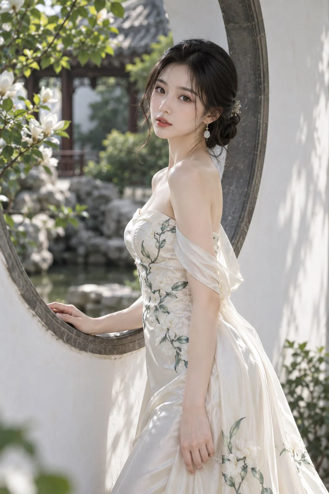

# Moon Window Magnolia New-Chinese Couture Portrait

**中文标题：** 月窗花影·玉兰新中式高定人像  
**ID:** `gi25-x-1123` · **Mode:** `generate`  
**Categories:** `general`  
**Tags:** `x-twitter`, `community`, `gpt-image-2.5`, `x-direct`, `zh`



### Moon Window Magnolia New-Chinese Couture Portrait

```text
2:3竖版，新中式高级定制礼服人像摄影，江南园林实景，象牙白与草木绿配色，清雅温柔，真实人物与细腻衣料质感。

一位25岁的成年东亚女性，清秀柔和的小鹅蛋脸，下颌自然收窄，下巴圆润，清澈杏眼，深棕色瞳孔，小巧自然的鼻梁，薄而小巧的淡玫瑰色嘴唇，双唇微微分开。肌肤冷白透亮，保留细微毛孔、绒毛与自然血色，脸颊和肩颈有柔润光泽，轻薄淡妆，避免过度磨皮。黑色长发松挽成低位发髻，额前与鬓边垂落几缕柔软发丝，发髻点缀小巧浅金色花簪，佩戴金色细链与乳白玉石水滴耳坠。

身穿象牙白真丝缎面新中式长礼服，无肩带抹胸设计，领口呈柔和的浅心形弧线，胸腰处立体裁剪，腰线贴合，裙摆自胯部向下逐渐展开。礼服绣有乳白色玉兰花、灰绿色叶片与深浅交错的纤细枝条，花纹从胸前沿腰侧向下延伸，在裙摆局部形成较大的花枝，疏密有致，刺绣略带立体感。缎面具有珍珠般柔润光泽，褶皱自然，面料厚实不透。两侧配轻薄的象牙白欧根纱垂袖，松松绕过上臂，在身体侧后方形成轻盈飘带，肩膀与锁骨完整露出。

人物站在白墙的圆形月洞窗旁，身体侧向画面左侧，与镜头形成约三分之二侧身角度，腰背自然舒展，头部轻轻转向镜头，目光温柔而专注，神态安静，带一点欲言又止的感觉。一只手向画面左侧伸出，指尖轻搭月洞窗下沿的深灰色石框；另一只手臂自然垂落，手指放松，轻触身侧裙面。肩颈线条自然，身体比例协调。

采用从头顶至膝下裙摆的四分之三身构图，脚部不入镜。人物位于画面中央偏右，面部在上方三分之一处。深灰色圆形窗框从画面左下方向上环绕，在人物头部与肩背后方形成优美弧线；右侧保留大面积带斑驳树影的白墙。画面左上方伸入盛开的白玉兰与嫩绿色枝叶，左下角有少量虚化花叶作为前景。透过月洞窗，可以看到园林池水、嶙峋假山、深色木构回廊和灰瓦屋顶，背景柔和虚化，保留可辨认的空间层次。

柔和的春日阳光从画面左上方侧后方照入，照亮发丝、肩颈和缎面褶皱，面部由白墙反射光自然补亮。肤色通透，亮部保留细节，阴影柔和，白色礼服与白墙之间有清晰的色温和明暗区分。整体呈现安静、清新、精致的新中式时装画报质感。模拟85mm人像镜头，适度浅景深，眼睛精准对焦，真实皮肤纹理，细致刺绣，无文字、无水印。

负面提示词： 动漫脸，夸张大眼，尖削下巴，厚嘴唇，塑料皮肤，蜡像感，过度磨皮，过曝，死白肤色，过度锐化，廉价化纤，透明裙身，婚纱头纱，夸张首饰，僵硬姿势，扭曲手腕，多余手指，手指粘连，身体比例失衡，圆窗变形，杂乱背景，文字，水印。
```

- **Recommended model:** `gpt-image-2.5-sunburst`
- **Settings:** _(defaults)_
- **Source:** [community](https://x.com/krienknight/status/2114914987059851675) — @krienknight
- **License note:** Original public X post; quoted with attribution — remix with attribution
- **Notes:** Collected directly from X; prompt posted as the author's reply https://x.com/krienknight/status/2114914987059851675 to https://x.com/krienknight/status/2114914986502050253, which carries the images and names GPT Image 2.5; discovered via X search, prompt re-verified against the original X post via api.fxtwitter.com; verified=True
- **Preview:** `previews/gi25-x-1123.webp`
