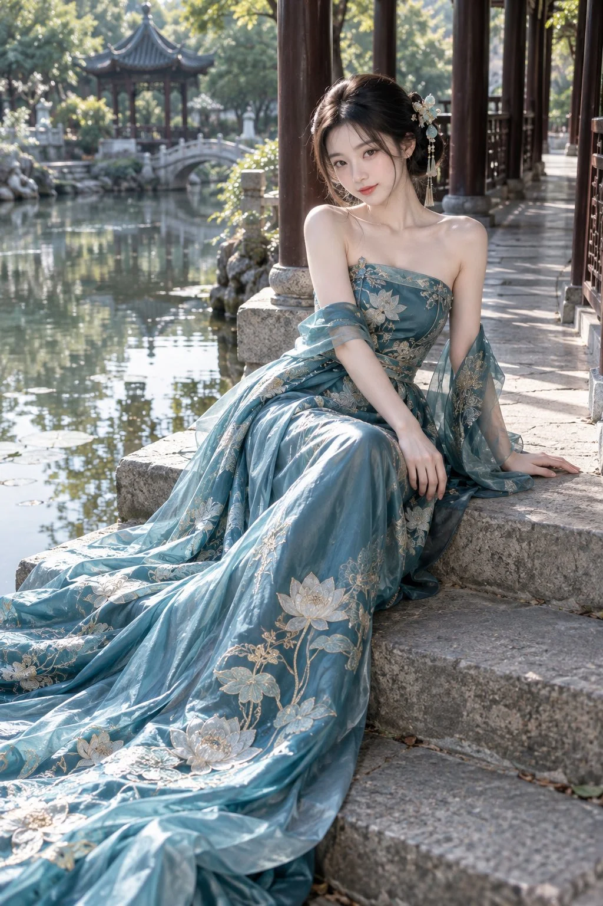

# Jiangnan Garden Lake-Blue Couture Portrait

**中文标题：** 江南园林湖蓝高定礼服人像  
**ID:** `gi25-x-1124` · **Mode:** `generate`  
**Categories:** `general`  
**Tags:** `x-twitter`, `community`, `gpt-image-2.5`, `x-direct`, `zh`



### Jiangnan Garden Lake-Blue Couture Portrait

```text
2:3 竖版，新中式高级定制礼服人像摄影，真实成年东方女性，江南园林实景，柔和通透的自然光，细腻真实的摄影质感。

一位25岁的成年东亚女性，清秀温婉，柔和的小鹅蛋脸，下颌自然收窄，下巴圆润，清澈杏眼，小巧自然的鼻梁，薄而小巧的淡红色嘴唇。皮肤白皙透亮，保留细微肌理、自然血色与柔和明暗，淡雅妆容。黑色长发松挽成低髻，两侧垂下少量细发，发髻侧面佩戴浅青玉石与白色花朵发饰，垂落纤细的金色流苏。

穿湖蓝偏青色的新中式抹胸长礼服，领口微斜，贴合身形的收腰剪裁，露出完整肩线与锁骨。礼服采用具有柔润光泽的高级真丝缎面，叠加轻盈薄纱，绣有大幅银白色莲花、浅金色枝蔓与细致荷叶纹样，刺绣精细、疏密有致。配同色透明薄纱披帛，自上臂松松滑落，绕过手肘并自然垂在身侧。裙摆宽大而修长，自膝部沿石阶铺展至画面左下角，形成大面积前景，丝绸褶皱自然，有真实重量感，莲花刺绣随裙褶起伏。

人物侧坐在临水回廊的灰色石阶上，身体朝向镜头，肩膀略微倾斜，上身轻轻前倾，头部微偏，温柔直视镜头，嘴角带浅淡笑意。一只手轻放在膝前的裙面上，手指自然舒展；另一只手在身体侧后方撑住石阶。双腿并拢斜向画面左前方，被长裙完整覆盖，脚部藏在裙摆内，坐姿舒展自然。

人物位于画面中右侧，面部位于上方三分之一附近，长裙向左下角延伸，形成对角线构图。右侧深褐色木柱、栏杆与石板回廊向远处递进；左侧是平静池水、细碎倒影、山石与绿树，背景可见一座白色石拱桥和灰瓦飞檐凉亭。背景适度虚化，仍能辨认园林建筑与空间层次。

清晨阳光从画面左后方穿过树叶，照亮发丝、肩颈和裙面，形成柔和轮廓光；面部有自然环境补光，肤色清透，高光保留细节。池面波光与回廊斑驳树影相互呼应。湖蓝、浅金、灰石与草木绿协调配色，宁静、清雅、精致。50mm人像摄影，适度浅景深，人物眼睛清晰，丝绸、刺绣与石阶纹理细腻，无文字、无水印。

负面提示词： 动漫脸，夸张大眼，尖下巴，宽厚嘴唇，塑料皮肤，过度磨皮，过曝，过度锐化，廉价化纤，僵硬裙摆，杂乱刺绣，肢体变形，多余手指，手指粘连，肩膀不对称，建筑扭曲，背景过度虚化，文字，水印。
```

- **Recommended model:** `gpt-image-2.5-sunburst`
- **Settings:** _(defaults)_
- **Source:** [community](https://x.com/krienknight/status/2114899893265567972) — @krienknight
- **License note:** Original public X post; quoted with attribution — remix with attribution
- **Notes:** Collected directly from X; prompt posted as the author's reply https://x.com/krienknight/status/2114899893265567972 to https://x.com/krienknight/status/2114899892825116853, which carries the images and names GPT Image 2.5; discovered via X search, prompt re-verified against the original X post via api.fxtwitter.com; verified=True
- **Preview:** `previews/gi25-x-1124.webp`
