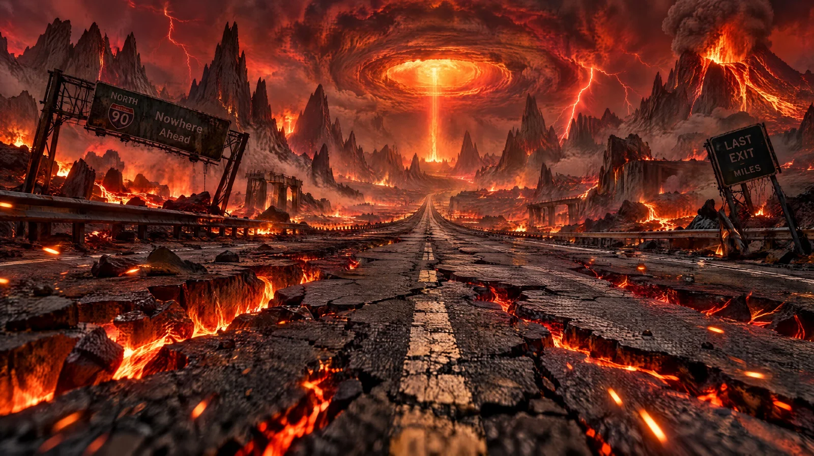

# Halloween Abandoned Highway into a Burning Horizon

**中文标题：** 万圣节·通往火光地平线的废弃公路  
**ID:** `gi25-x-1125` · **Mode:** `generate`  
**Categories:** `general`  
**Tags:** `x-twitter`, `community`, `gpt-image-2.5`, `x-direct`, `en`



### Halloween Abandoned Highway into a Burning Horizon

```text
An endless abandoned highway stretches straight into a terrifying apocalyptic landscape. Cracked black asphalt splits apart above rivers of glowing molten lava. Gigantic jagged obsidian mountains rise on either side, their silhouettes illuminated by a blazing crimson sky filled with volcanic ash, distant firestorms, and violent red lightning. Charred highway signs lean at impossible angles. Burning embers drift across the road. The highway disappears into a colossal circular opening in the storm clouds radiating ominous orange light. Ground-level cinematic road perspective, dramatic leading lines, immense atmospheric depth, realistic heat distortion, ultra-detailed asphalt, physically accurate fire illumination and volcanic smoke, large-format Hollywood cinematography, extreme micro-detail, 16:9.
```

- **Recommended model:** `gpt-image-2.5-sunburst`
- **Settings:** _(defaults)_
- **Source:** [community](https://x.com/DJpowers69/status/2114913741489987803) — @DJpowers69
- **License note:** Original public X post; quoted with attribution — remix with attribution
- **Notes:** Collected directly from X; prompt posted as the author's own reply https://x.com/DJpowers69/status/2114913741489987803 (with its own images) in the thread https://x.com/DJpowers69/status/2114913715355254786, whose first post names GPT Image 2.5; discovered via X search, prompt re-verified against the original X post via api.fxtwitter.com; verified=True; from a Halloween prompt thread comparing GPT Image 2.5 Sunburst with Nano Banana; preview is the image labeled GPT2.5 Starburst
- **Preview:** `previews/gi25-x-1125.webp`
