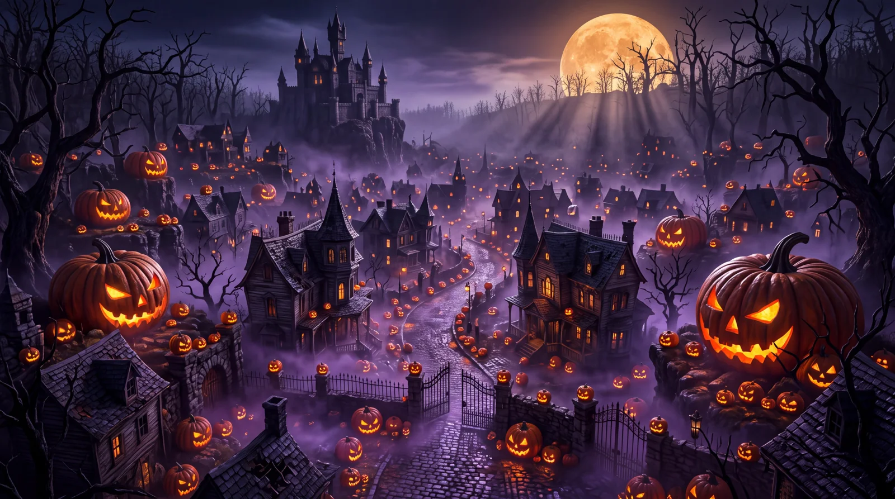

# Halloween Supernatural Pumpkin Kingdom

**中文标题：** 万圣节·超自然南瓜王国  
**ID:** `gi25-x-1126` · **Mode:** `generate`  
**Categories:** `general`  
**Tags:** `x-twitter`, `community`, `gpt-image-2.5`, `x-direct`, `en`



### Halloween Supernatural Pumpkin Kingdom

```text
An enormous supernatural Halloween kingdom hidden inside a valley of twisted dead trees. Thousands of intricately carved jack-o’-lanterns illuminate winding cobblestone streets, crooked Victorian mansions, and a towering haunted castle in the distance. Giant pumpkins, some as large as houses, glow with sinister internal firelight. Purple ground fog drifts between ancient stone walls and rusted iron gates. A massive amber harvest moon hangs low behind black skeletal branches. Cinematic aerial three-quarter establishing perspective revealing extraordinary environmental scale. Rich burnt-orange, violet, midnight-blue, and black color palette. Realistic candlelight scattering, intricate pumpkin rind textures, authentic wet cobblestones, detailed architectural weathering, volumetric moonbeams, premium large-format photorealism, 16:9.
```

- **Recommended model:** `gpt-image-2.5-sunburst`
- **Settings:** _(defaults)_
- **Source:** [community](https://x.com/DJpowers69/status/2114913756455346585) — @DJpowers69
- **License note:** Original public X post; quoted with attribution — remix with attribution
- **Notes:** Collected directly from X; prompt posted as the author's own reply https://x.com/DJpowers69/status/2114913756455346585 (with its own images) in the thread https://x.com/DJpowers69/status/2114913715355254786, whose first post names GPT Image 2.5; discovered via X search, prompt re-verified against the original X post via api.fxtwitter.com; verified=True; from a Halloween prompt thread comparing GPT Image 2.5 Sunburst with Nano Banana; preview is the image labeled GPT2.5 Starburst
- **Preview:** `previews/gi25-x-1126.webp`
