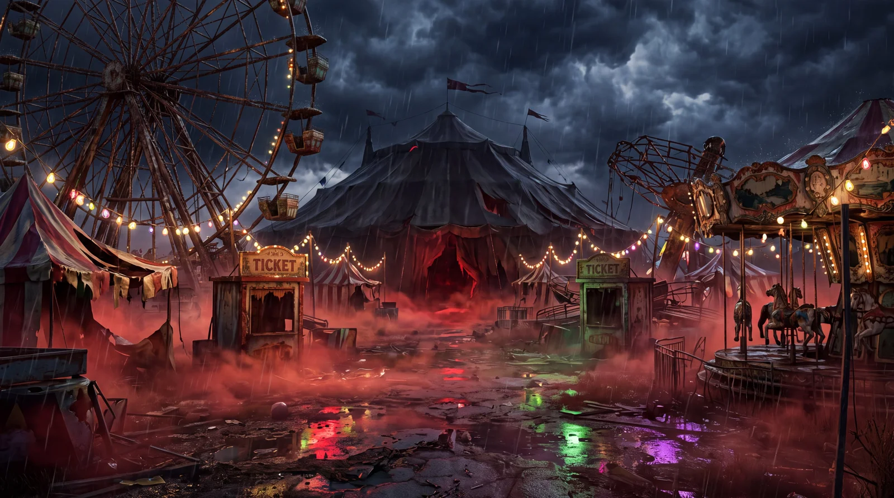

# Halloween Abandoned 1930s Carnival

**中文标题：** 万圣节·废弃 1930 年代游乐场  
**ID:** `gi25-x-1127` · **Mode:** `generate`  
**Categories:** `general`  
**Tags:** `x-twitter`, `community`, `gpt-image-2.5`, `x-direct`, `en`



### Halloween Abandoned 1930s Carnival

```text
A gigantic abandoned 1930s carnival stands in a deserted field under violent midnight storm clouds. A towering rust-covered Ferris wheel looms over broken carnival tents, a decaying carousel, abandoned ticket booths, and twisted amusement rides. Hundreds of antique incandescent carnival bulbs flicker erratically through dense ground-hugging crimson fog. Rain-soaked pavement reflects blood-red, sickly green, and electric purple illumination. Torn striped canvas flaps in the wind. A colossal dark circus tent dominates the background, its entrance glowing ominously from within. Cinematic ground-level ultra-wide establishing shot, symmetrical depth, realistic rain droplets, intricate rust and peeling paint textures, authentic aged machinery, dimensional volumetric lighting, extreme cinematic photorealism, 16:9.
```

- **Recommended model:** `gpt-image-2.5-sunburst`
- **Settings:** _(defaults)_
- **Source:** [community](https://x.com/DJpowers69/status/2114913772016206210) — @DJpowers69
- **License note:** Original public X post; quoted with attribution — remix with attribution
- **Notes:** Collected directly from X; prompt posted as the author's own reply https://x.com/DJpowers69/status/2114913772016206210 (with its own images) in the thread https://x.com/DJpowers69/status/2114913715355254786, whose first post names GPT Image 2.5; discovered via X search, prompt re-verified against the original X post via api.fxtwitter.com; verified=True; from a Halloween prompt thread comparing GPT Image 2.5 Sunburst with Nano Banana; preview is the image labeled GPT2.5 Starburst
- **Preview:** `previews/gi25-x-1127.webp`
