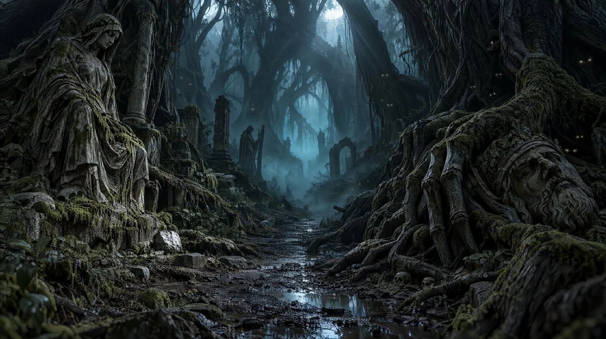

# Halloween Ancient Supernatural Forest

**中文标题：** 万圣节·远古超自然森林  
**ID:** `gi25-x-1128` · **Mode:** `generate`  
**Categories:** `general`  
**Tags:** `x-twitter`, `community`, `gpt-image-2.5`, `x-direct`, `en`



### Halloween Ancient Supernatural Forest

```text
Deep inside an ancient supernatural forest, gigantic twisted black trees form a cathedral-like canopy hundreds of feet overhead. Their roots resemble massive skeletal fingers gripping the earth. A narrow muddy pathway vanishes into thick turquoise-blue fog. Countless faint glowing eyes peer from deep within the darkness between the trees. Abandoned stone statues are partially swallowed by moss and tangled roots. Pale silver moonbeams penetrate narrow openings in the canopy, revealing suspended mist, drifting spores, and fine particles. The environment feels impossibly ancient, threatening, and alive. Low eye-level cinematic composition with exceptional foreground-to-background depth, 24mm large-format lens, intricate bark and moss textures, realistic damp earth, atmospheric light scattering, deep organic shadows, absolute photorealism, 16:9.
```

- **Recommended model:** `gpt-image-2.5-sunburst`
- **Settings:** _(defaults)_
- **Source:** [community](https://x.com/DJpowers69/status/2114913786222330271) — @DJpowers69
- **License note:** Original public X post; quoted with attribution — remix with attribution
- **Notes:** Collected directly from X; prompt posted as the author's own reply https://x.com/DJpowers69/status/2114913786222330271 (with its own images) in the thread https://x.com/DJpowers69/status/2114913715355254786, whose first post names GPT Image 2.5; discovered via X search, prompt re-verified against the original X post via api.fxtwitter.com; verified=True; from a Halloween prompt thread comparing GPT Image 2.5 Sunburst with Nano Banana; preview is the image labeled GPT2.5 Starburst
- **Preview:** `previews/gi25-x-1128.webp`
