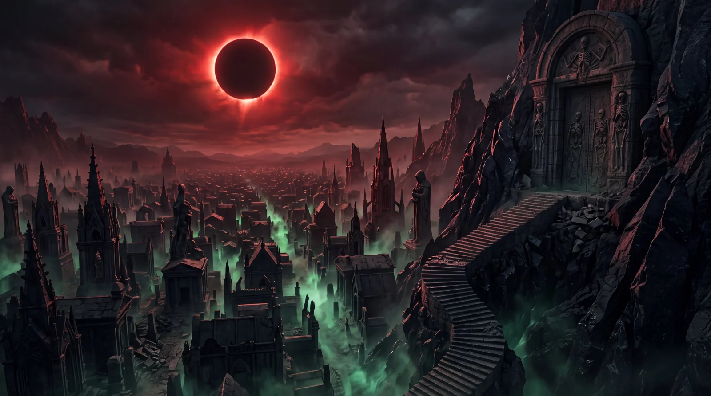

# Halloween Vast Ancient Necropolis

**中文标题：** 万圣节·广袤远古墓城  
**ID:** `gi25-x-1129` · **Mode:** `generate`  
**Categories:** `general`  
**Tags:** `x-twitter`, `community`, `gpt-image-2.5`, `x-direct`, `en`



### Halloween Vast Ancient Necropolis

```text
An unimaginably vast ancient necropolis stretches across a dead valley beneath an enormous crimson eclipse. Millions of black stone tombs, towering mausoleums, skeletal Gothic monuments, and colossal funerary statues extend to the horizon. A monumental staircase carved into an obsidian mountainside leads to a gigantic sealed stone doorway surrounded by ancient skeletal carvings. Ghostly emerald-green mist pours through narrow streets between the tombs while crimson light illuminates the jagged skyline. Cinematic aerial establishing view emphasizing overwhelming architectural scale and eerie silence. Extraordinary stone craftsmanship, detailed erosion, realistic atmospheric perspective, layered volumetric fog, premium photorealistic dark-fantasy cinematography, 16:9.
```

- **Recommended model:** `gpt-image-2.5-sunburst`
- **Settings:** _(defaults)_
- **Source:** [community](https://x.com/DJpowers69/status/2114913798922633516) — @DJpowers69
- **License note:** Original public X post; quoted with attribution — remix with attribution
- **Notes:** Collected directly from X; prompt posted as the author's own reply https://x.com/DJpowers69/status/2114913798922633516 (with its own images) in the thread https://x.com/DJpowers69/status/2114913715355254786, whose first post names GPT Image 2.5; discovered via X search, prompt re-verified against the original X post via api.fxtwitter.com; verified=True; from a Halloween prompt thread comparing GPT Image 2.5 Sunburst with Nano Banana; preview is the image labeled GPT2.5 Starburst
- **Preview:** `previews/gi25-x-1129.webp`
