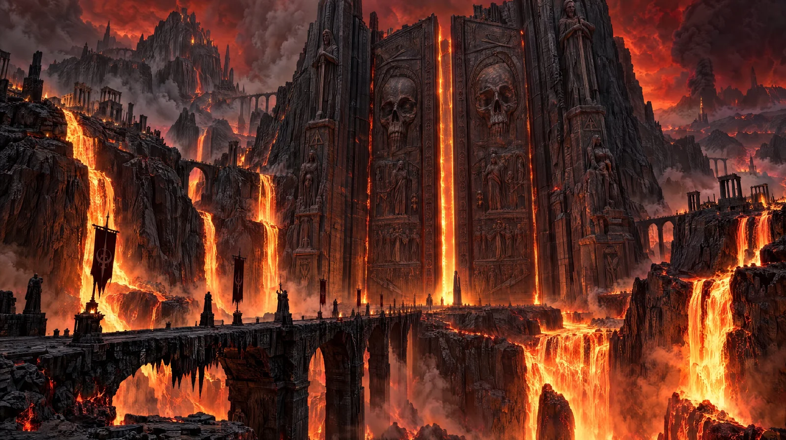

# Halloween Colossal Obsidian Gates

**中文标题：** 万圣节·巨型黑曜石之门  
**ID:** `gi25-x-1130` · **Mode:** `generate`  
**Categories:** `general`  
**Tags:** `x-twitter`, `community`, `gpt-image-2.5`, `x-direct`, `en`



### Halloween Colossal Obsidian Gates

```text
Two impossibly gigantic ancient obsidian gates rise between towering volcanic cliffs at the edge of the underworld. The gates are intricately carved with colossal skulls, forgotten inscriptions, and weathered stone reliefs. Vast molten lava waterfalls pour down the surrounding cliffs into a glowing chasm. A narrow black stone bridge crosses the abyss toward the sealed gates. Violent orange firelight radiates through cracks between the enormous doors while atmospheric smoke rises into a dark crimson sky. Tiny distant ruins establish the overwhelming scale of the structure. Ultra-wide cinematic composition, physically accurate volcanic illumination, extreme surface micro-detail, dramatic atmospheric depth, massive volumetric smoke formations, extraordinary optical realism, Hollywood dark-fantasy epic, 16:9.
```

- **Recommended model:** `gpt-image-2.5-sunburst`
- **Settings:** _(defaults)_
- **Source:** [community](https://x.com/DJpowers69/status/2114913812113740036) — @DJpowers69
- **License note:** Original public X post; quoted with attribution — remix with attribution
- **Notes:** Collected directly from X; prompt posted as the author's own reply https://x.com/DJpowers69/status/2114913812113740036 (with its own images) in the thread https://x.com/DJpowers69/status/2114913715355254786, whose first post names GPT Image 2.5; discovered via X search, prompt re-verified against the original X post via api.fxtwitter.com; verified=True; from a Halloween prompt thread comparing GPT Image 2.5 Sunburst with Nano Banana; preview is the image labeled GPT Image 2.5 Sunburst
- **Preview:** `previews/gi25-x-1130.webp`
