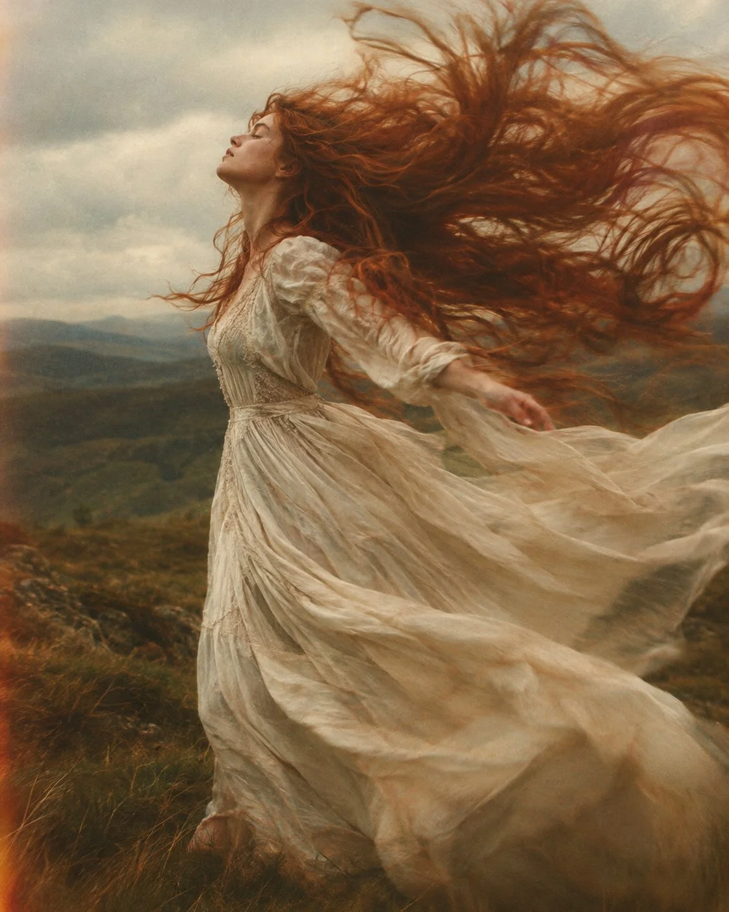

# Ethereal Windswept Ivory Dress Fine-Art Portrait

**中文标题：** 风中象牙白长裙·空灵艺术人像  
**ID:** `gi25-x-1133` · **Mode:** `generate`  
**Categories:** `general`  
**Tags:** `x-twitter`, `community`, `gpt-image-2.5`, `x-direct`, `en`



### Ethereal Windswept Ivory Dress Fine-Art Portrait

```text
A breathtaking, ethereal cinematic photograph of a young woman in a flowing ivory-white vintage dress, captured in profile with her eyes gently closed and her face lifted toward the wind. Her long, voluminous auburn hair explodes dramatically through the air in enormous flowing arcs, creating a surreal, painterly halo around her head and body. Her arms extend gracefully outward, the fabric of her dress and hair swirling together in a beautiful dance of movement. She stands in an open, windswept landscape beneath a pale, overcast sky, with distant dark olive-green hills fading into the background.

Art direction: romantic fine-art photography, pre-Raphaelite painting meets vintage analog film, dreamlike motion blur, long-exposure movement, soft atmospheric haze, rich burnt-orange and copper-red tones, muted sage green, warm cream highlights, deep earthy shadows, visible 35mm film grain, subtle halation, imperfect focus, painterly textures, natural diffused lighting, soft contrast, organic color grading, emotionally evocative and otherworldly atmosphere.

Composition: vertical portrait, full-body three-quarter view, subject positioned slightly left of center, dramatic sweeping hair filling the upper and right portions of the frame, flowing fabric and motion trails dominating the foreground, shallow depth of field, dynamic diagonal movement, spontaneous and unposed feeling.

Shot on vintage 35mm film, 50mm lens, f/2, slow shutter speed to capture flowing movement, high-end editorial art photography, fine-art museum aesthetic, photorealistic details blended with impressionistic motion, cinematic and timeless, 4:5 vertical aspect ratio.

Avoid: cartoon style, CGI appearance, plastic skin, oversharpening, artificial colors, stiff poses, perfectly frozen hair, excessive digital clarity, text, watermarks.
```

- **Recommended model:** `gpt-image-2.5-sunburst`
- **Settings:** _(defaults)_
- **Source:** [community](https://x.com/iamsofiaijaz/status/2115343261862924583) — @iamsofiaijaz
- **License note:** Original public X post; quoted with attribution — remix with attribution
- **Notes:** Collected directly from X; prompt posted as the author's own reply https://x.com/iamsofiaijaz/status/2115343261862924583 to https://x.com/iamsofiaijaz/status/2115343032731992439, which carries the images; GPT Image 2.5 is named in the parent post; discovered via X search, prompt re-verified against the original X post via api.fxtwitter.com; verified=True; prompt 2 of 2 posted as the author's reply; preview is image 2 of the parent post
- **Preview:** `previews/gi25-x-1133.webp`
