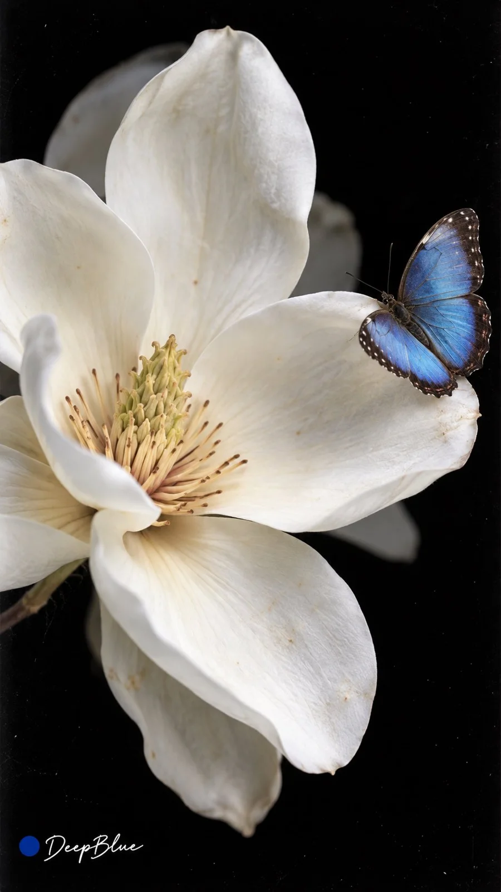

# Scanography Flowers & Leaves Surreal Object Series (n=10)

**中文标题：** 扫描摄影·花叶超现实物件系列（n=10）  
**ID:** `gi25-x-1137` · **Mode:** `generate`  
**Categories:** `general`  
**Tags:** `x-twitter`, `community`, `gpt-image-2.5`, `x-direct`, `zh`



### Scanography Flowers & Leaves Surreal Object Series (n=10)

```text
掃描攝影 Scanography × 花朵與樹葉 × 超現實物件組合 × 真實數字掃描成像

n=10，每次獨立生成一張9:16豎版圖片，逐張輸出，不製作拼圖。每張選擇不同的花朵或樹葉作為主體，從12種玩法中選擇不同方向，變化物件組合、排列與構圖，形成具有收藏價值的實驗掃描攝影系列。

12種玩法：花瓣解構、葉脈透視、機械共生、昆蟲棲息、植物珠寶、透明包裹、果實聯想、植物與文字、破碎與生長、植物標本、形態仿生、時間痕跡。

每張選擇一種具有鮮明輪廓、結構或色彩的花朵或樹葉，保留其可辨識的自然形態。再選擇與植物具有形態呼應、材質反差或故事關聯的物件，讓彼此形成一個容易看懂、有想像力的視覺關係。每張合計使用2至5種物件，包含植物主體。

花朵或樹葉佔據畫面的主要視覺面積，其他物件圍繞主體形成必要的互動、遮擋或延伸，保持主次分明。允許植物局部放大、貼近畫面邊緣或裁切，利用形狀、色彩與材質對比創造視覺衝擊力，保留適量留白。

以真實平板掃描儀直接成像為視覺基礎。植物與物件貼放或略微離開掃描玻璃，畫面呈現近乎平面的空間與明確的接觸、疊壓關係。貼近玻璃的部分清晰，離開玻璃的部分自然變柔，保留掃描光源照亮物件表面的直接感，以及花瓣、葉脈和其他材質的細節。

可依構圖需要使用透明材質疊層。部分作品可在掃描過程中移動植物或物件，讓局部形體沿掃描方向產生拉伸、壓縮或錯位；其餘靜止部分保持清晰。

背景以深黑為主，也可依主體選擇純白或低飽和單色。控制物件數量與細節密度，讓植物主體輪廓清楚，畫面乾淨、有秩序，同時保留真實材質的細節。

左下签名：深蓝色实心圆点在前，白色手写体「DeepBlue」在后。
```

- **Recommended model:** `gpt-image-2.5-sunburst`
- **Settings:** _(defaults)_
- **Source:** [community](https://x.com/DeepBlueX0/status/2115292980613620073) — @DeepBlueX0
- **License note:** Original public X post; quoted with attribution — remix with attribution
- **Notes:** Collected directly from X; original post https://x.com/DeepBlueX0/status/2115292980613620073; post text names GPT Image 2.5; discovered via X search, prompt re-verified against the original X post via api.fxtwitter.com; verified=True
- **Preview:** `previews/gi25-x-1137.webp`
