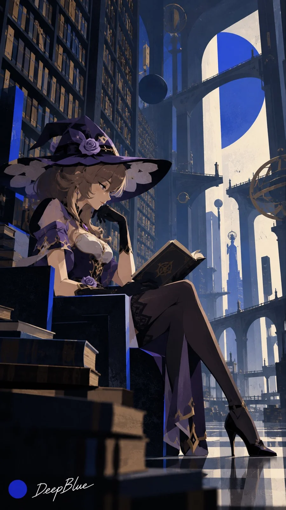

# Anime Heroines in Zima Blue Animation Style (n=10)

**中文标题：** 动漫女角色×《齐马蓝》动画画风（n=10）  
**ID:** `gi25-x-1138` · **Mode:** `generate`  
**Categories:** `general`  
**Tags:** `x-twitter`, `community`, `gpt-image-2.5`, `x-direct`, `zh`



### Anime Heroines in Zima Blue Animation Style (n=10)

```text
主体：动漫或游戏女性角色 ×《爱，死亡和机器人：齐马蓝》动画画风

从主体池中随机抽取10个不同主体，每张呈现一个，保留各主体辨识特征。

视觉语言：棱角化造型 × 夸张比例 × 硬边平涂 × 局部印刷颗粒 × 超现实尺度 × 局部齐马蓝。

主体与环境统一风格，场景随主体设计。各张变化姿态、视角、景别与空间关系，避免重复构图。

9:16竖版，n=10，10张独立单图，不拼图。每张左下角深蓝色实心圆点，空格后接白色手写体“DeepBlue”。
```

- **Recommended model:** `gpt-image-2.5-sunburst`
- **Settings:** _(defaults)_
- **Source:** [community](https://x.com/DeepBlueX0/status/2115254224422682852) — @DeepBlueX0
- **License note:** Original public X post; quoted with attribution — remix with attribution
- **Notes:** Collected directly from X; original post https://x.com/DeepBlueX0/status/2115254224422682852; post text names GPT Image 2.5; discovered via X search, prompt re-verified against the original X post via api.fxtwitter.com; verified=True
- **Preview:** `previews/gi25-x-1138.webp`
