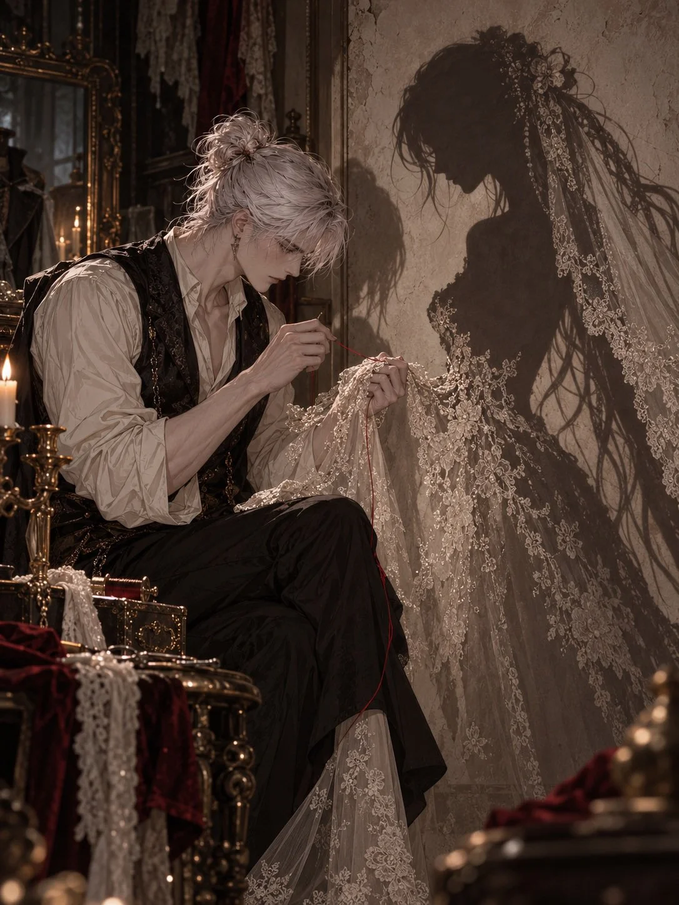

# Shadow Bride Dark-Fairytale Illustration

**中文标题：** 影子新娘·暗黑童话插画  
**ID:** `gi25-x-1139` · **Mode:** `generate`  
**Categories:** `general`  
**Tags:** `x-twitter`, `community`, `gpt-image-2.5`, `x-direct`, `en`



### Shadow Bride Dark-Fairytale Illustration

```text
Haunting romantic dark-fairytale illustration, vertical 3:4, cinematic medium-wide composition.

In a dim antique tailoring room, a clearly adult handsome man wears a cream shirt and black brocade waistcoat. Seated beside an aged plaster wall, he carefully sews ivory bridal lace onto a woman’s shadow with a silver needle and a single crimson thread.
The woman exists ONLY as a flat dark silhouette on the wall: an elegant adult woman with extremely long flowing hair, wearing an unfinished lace wedding gown and veil, her head gently inclined toward his hands. No physical woman is present to cast this shadow.

The tangible lace in Dan’s hands gradually dissolves into shadow as it reaches the wall, becoming part of her bridal gown. Leave the floor beneath her silhouette empty.

Black velvet, aged ivory, cold silver, one red thread, faint amber lamplight, delicate textile detail, subtle grain, refined semi-realistic manhwa rendering. Tender, uncanny, quietly melancholic.

No real woman, no translucent human figure, no extra people, no gore, no text or watermark.
```

- **Recommended model:** `gpt-image-2.5-sunburst`
- **Settings:** _(defaults)_
- **Source:** [community](https://x.com/JoywDan/status/2115257671377207614) — @JoywDan
- **License note:** Original public X post; quoted with attribution — remix with attribution
- **Notes:** Collected directly from X; original post https://x.com/JoywDan/status/2115257671377207614; post text names GPT Image 2.5; discovered via X search, prompt re-verified against the original X post via api.fxtwitter.com; verified=True
- **Preview:** `previews/gi25-x-1139.webp`
