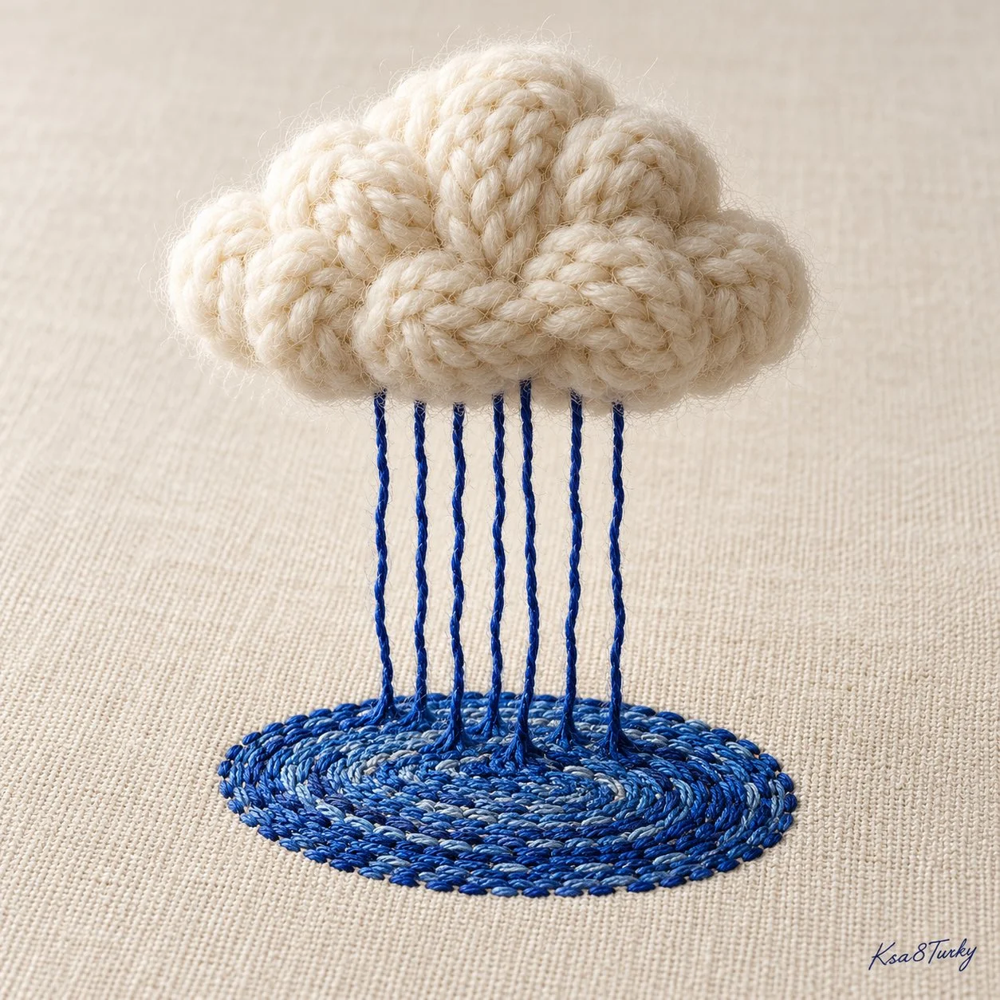

# Natural Phenomenon Reimagined in One Craft Material

**中文标题：** 自然现象×单一手工材质超现实静物模板  
**ID:** `gi25-x-1140` · **Mode:** `generate`  
**Categories:** `general`  
**Tags:** `x-twitter`, `community`, `gpt-image-2.5`, `x-direct`, `en`



### Natural Phenomenon Reimagined in One Craft Material

```text
Create a premium square handmade surreal editorial photograph of [NATURAL PHENOMENON] entirely reimagined using [ONE CRAFT MATERIAL]. Keep the source, motion and final trace materially coherent. Example: a pearl-white knitted cloud rains cobalt yarn that becomes an embroidered puddle on ivory linen. Macro fibers, refined stitches, realistic shadows and soft side light. Clean composition, no people or extra props. Small handwritten Ksa8Turky at bottom right
```

- **Recommended model:** `gpt-image-2.5-sunburst`
- **Settings:** _(defaults)_
- **Source:** [community](https://x.com/ksa8Turky/status/2115190047372919113) — @ksa8Turky
- **License note:** Original public X post; quoted with attribution — remix with attribution
- **Notes:** Collected directly from X; original post https://x.com/ksa8Turky/status/2115190047372919113; post text names GPT Image 2.5; discovered via Bin0754/gpt-image-gallery index, prompt re-verified against the original X post via api.fxtwitter.com; verified=True
- **Preview:** `previews/gi25-x-1140.webp`
